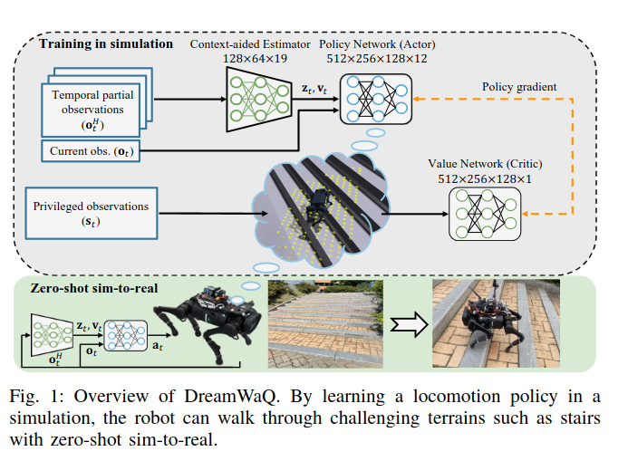
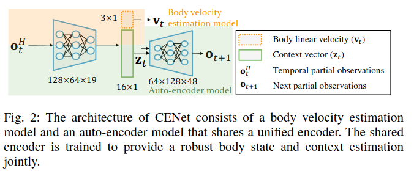

# dreamwaq笔记

## 一、网络结构

## 二、Context-aided Estimator：

### 1、学习的分类

自监督学习，监督学习，无监督学习

dreamwaq里面的cenet就使用了自监督学习的方法

自监督学习答案存在于数据中

自监督有四类，预测式，重建式，对比式，掩码式

重建式也叫自编码（AE），自编码是自监督的一种实现方式，但不是全部

### 2、变分自编码（VAE）：

encoder 输出 μ 和 σ²  →  采样 z ~ N(μ, σ²)  →  decoder 重建 x̂
       
普通 AE 的 latent 空间可能"有洞"（两个有效编码之间是无意义的区域，VAE通过使得编码为概率分布，使得隐向量空间连续。beta-VAE通过调节kl散度的力度，使得将编码拉回标准正态分布的力度可调节，靠着kl正则，使得隐向量空间是一个连续的高斯球。

最后损失是这样的：$$ L_{est}= MSE(\tilde{v_t}, v_t)$$ 

$$L_{VAE} = M SE(\tilde{o_{t+1}}, o_{t+1}) + βDKL(q(z_t|o^H_
t ) ∥ p(zt))$$ 

> 高斯球

Dreamwaq中速度使用监督学习，zt使用自监督（beta-VAE方法）.

### 3、整个过程描述：

$o^H_t=\{o_t, o_{t-1}, \dots, o_{t-H}\}$（过去 H 帧本体感受观测，论文取 **H = 5**；225 维，纯 MLP）输入 CENet。CENet 是「**单一共享编码器 + 多头**」结构：共享编码器把 $o^H_t$ 编码出两路——一路是 3 维基座线速度的**确定性估计** $\tilde v_t$；另一路是 16 维上下文 $z_t$ 的**高斯后验** $q(z_t|o^H_t)$ 的参数（沿用标准 β-VAE，即逐维对角的均值与方差）。从这个后验中重参数化采样得到 $z_t \in \mathbb{R}^{16}$，送入解码器预测**下一帧**观测 $\tilde o_{t+1}$（45 维）。

KL 正则**只加在 16 维上下文的后验上**（对角结构），速度那一路没有任何正则项。先验取标准正态的理由：所有观测都已归一化到零均值、单位方差。然后对于cenet来说，对两项损失求导反向传播，沿着梯度更新编码器和解码器。

关于这个kl散度，将分布拉向16维独立的高斯分布，这样可以使得kl有闭式解（代码实现），另外因为是N(0,I)，所以对于观测，我们需要归一化到1,不然不同尺度的观测都编码到标准高斯，会出问题。

kl散度在这里用作损失还有一个作用，kl一般分解可以分解成三项，其中一项叫做tc项，这一项表示的是维度间的耦合程度，最小化kl,实际上也在最小化tc,这样的效果就是使得逼迫16维每一维都尽量表达不同的信息。

### 4、adpboot 自适应自举

如果一开始就给actor网络的速度向量就是cenet估计出来的网络，那么一开始这个速度噪声很大，很不好，这里作者用了一个小trick来显著提高效果：m个奖励向量的标准差/奖励的平均值=cv,cv用来衡量奖励是否平均，因为对于域随即化来说，不同的环境奖励接近才是更好的
$$p_{boot} = 1 − tanh(CV (R))$$
这个pboot具体是每一轮计算投一次骰子，然后决定所有环境是否自举，还是每个环境单独掷骰子，决定当前环境是否自举，论文原文写的不清楚，但倾向于认为是第二种。

## 三、复现要点

### 1、非对称actor-critic
$$o_t = [ω_t,g_t,c_t,θ_t,\dotθ_t,a_{t−1}]$$
$$st =[o_t,v_t,d_t,h_t]$$

### 2、CENET复现

网络结构改为$o_t^5=\{o_t,o_{t-1},...,o_{t-5}\}$输入一个225->128->64->35的网络，也就是输入225,中间层128->64,输出层35,输出层的35意思是16个u,16个方差，再加三个速度，将16个u和16个方差组成16维度高斯分布后采样得到16维度latent,然后算上速度得到一个19维的向量，前3维为速度估计量，后16维为latent。然后这19维度直接输入进actor网络里面，actor网络隐藏层512->256->128，输出12个动作。用上述的两节网络代替原来的一个actor网络，损失函数里面相比于leggedgym新增：
$$L_{est}= MSE(\tilde{v_t}, v_t)$$

$$L_{VAE} = M SE(\tilde{o_{t+1}}, o_{t+1}) + βDKL(q(z_t|o^H_t ) ∥ p(zt))$$

其中DKL项的闭式解为：

> 总而言之就是两件事，1.用cenet代替原来的actor网络。2.多加了两个损失函数

### 3、AdaBoot

训练的时候每一轮计算$$ pboot = 1 − tanh(CV (R))$$

其中，$CV(R)=std(R)/mean(R)$,$R$就是4096个环境这一轮各自的奖励

### 4、值得注意的点

功率近似奖励机制：$$ var(\tau\cdot\dot\theta)^2 $$
