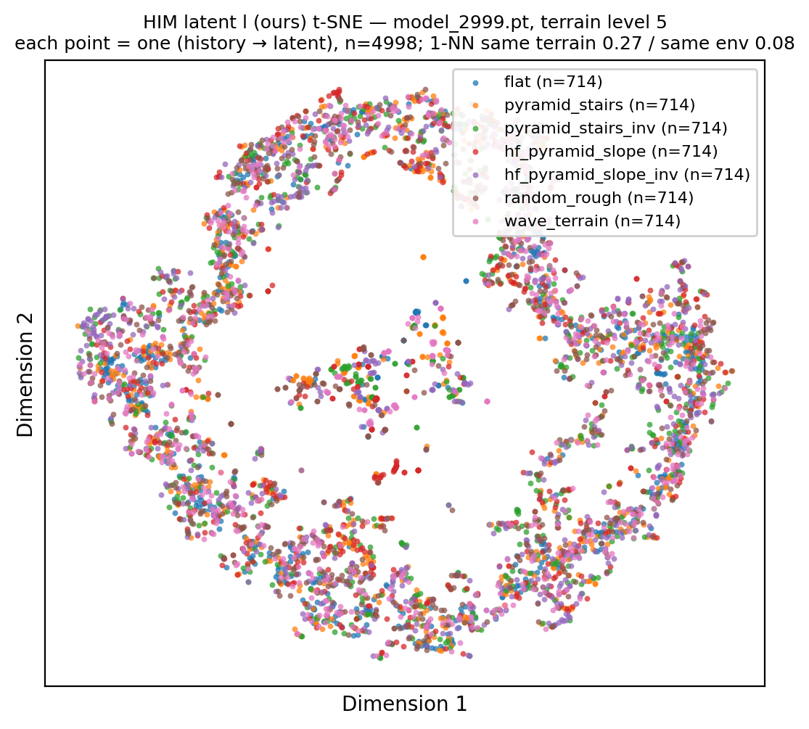
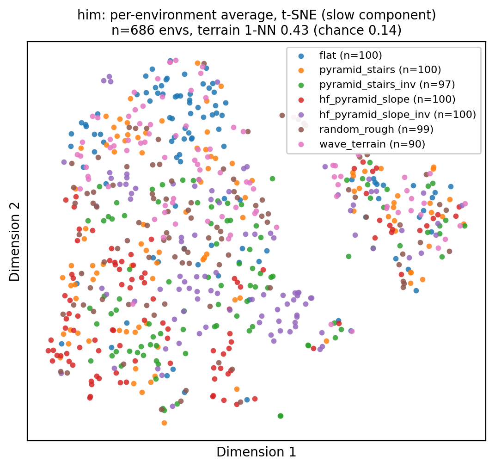

# HIM latent 到底编码了什么：地形，还是步态相位？

> 对象：Go1 rough 任务（`Mjlab-HIM-Rough-Unitree-Go1`）与对照 DreamWaQ
> （`Mjlab-DreamWaQ-Rough-Unitree-Go1`）。§1–§9 保留历史实验记录；§10 是
> 2026-10-17 官方观测尺度、`temperature=0.1`、估计器梯度修复后的最新评估。
> 数据与脚本都在 `实验数据/`：`tsne_latent.py`（采样 + t-SNE）、`phase_check.py`
> （步态相位）、`latent_decompose.py`（相位残差 / 环境平均）、`tsne_compare.py`（并排图）。
> 历史运行主要评估 level 3/5、前进指令 1.0 m/s；最新运行按同样 level 5 协议评估。
> 详细实验流水见 `实验记录.md`。
>
> **2026-10-17 指标修正**：旧版相位 R² 的分母未中心化，导致 latent 的常数偏置被算作
> 相位解释；有效维度也曾误用奇异值而非 PCA 方差特征值。本文数字、图和 JSON 已按
> 中心化方差重算。相位残差和地形 1-NN 的数值不受影响。

## 结论（先说结果）

1. **最新模型的 latent 已不再准一维**：16 维逐帧 latent 的 PCA 有效维度约 **7.38**，
   而历史 K=32 run 只有 1.06；表示从单方向主导变成了更分散的多方向表示。
2. **最新模型的相位依赖明显下降**：一次谐波相位只解释 **20.3%** 的 latent 方差。
   去掉相位成分后，逐帧地形 1-NN 仍为 **0.269**，与原始 latent 的 0.269 基本不变；
   不能用"主要编码步态相位"解释当前 latent。
3. **但逐帧 latent 仍没有清晰的七类地形聚类**：t-SNE 和 16 维原始 latent 的地形
   1-NN 都只有 **0.269**，5-NN 多数可分性约 **0.25**，随机基线 0.143。
   图中七种颜色仍是连续混合的高维流形。
4. **慢变成分里有中等强度的地形信号**：每环境平均后，地形 1-NN 达到 **0.427**，
   5-NN 多数可分性 **0.405**，约为随机基线的三倍；但图上仍没有七个清晰独立的簇。
   当前应表述为"HIM 编码了一部分慢变环境信息"，而不是"已经形成地形分类器"。
5. **换到当前配置后，地形可分性没有比历史 run 更好**：同是 level 5，16 维逐帧
   1-NN 从历史 0.331 降到 **0.269**，每环境平均从 0.454 降到 **0.427**。不过新 run
   同时改变了观测尺度、温度和梯度裁剪，不能把变化归因于单一因素。
6. **历史运行和原版对照仍有参考价值**：§1–§9 中的 K=16/K=32、CENet 和 Isaac Gym
   结果记录的是旧配置。它们说明旧 mjlab HIM 曾准一维且相位占比更高，也说明原版和
   CENet 在慢变成分上有更强的地形组织；这些结论不能被直接套用到最新模型。

## 1. 三臂 t-SNE（逐帧 latent，按地形上色）


每类 714 点、共 4998 点，t-SNE（perplexity 30、750 次迭代）。三张图都是**颜色混合**
的连续流形，没有按地形分簇。

| latent | t-SNE 1-NN 同地形 | 16 维 1-NN 同地形 | 类间/类内中心距 | PC1 占比 | 参与率（有效维度） |
| --- | --- | --- | --- | --- | --- |
| HIM `l`，K=16（旧 run） | 0.238 | 0.260 | 0.102 | 85.8% | 1.33 |
| HIM `l`，K=32（新 run） | 0.207 | 0.228 | 0.063 | **97.7%** | **1.05** |
| CENet μ（DreamWaQ） | **0.296** | **0.302** | **0.154** | 43.6% | **2.75** |
| 随机基线 | 0.143 | 0.143 | — | — | — |

（"1-NN 同地形"= 每个点的最近邻是否与它同一种地形的比例；参与率 = (Σλ)²/Σλ²，
见文末名词表。）

## 2. 不经过 t-SNE 的 PCA：HIM 的 latent 是"准一维"的


PCA（线性、不做非线性加工）显示：K=32 的 HIM latent 有 **97.7% 的方差集中在 PC1**，
有效维度约 **1.05** —— 所有样本几乎落在同一条曲线上；CENet 的有效维度约 **2.75**，
主流形接近二维（43.6% + 40.0%）。所以 t-SNE 的"环/长丝"不是算法伪影，而是**数据本身
就低维**。而且维度越低，地形可分性越差（CENet 2.75 > K16 1.33 > K32 1.05 对应
0.296 > 0.238 > 0.207）。

注意："PC1-PC2 散点图"总是二维画法。散点有一定竖直宽度、或一维曲线弯成 U 形，不等于
数据有两个等效自由度；应看 PC1 占比和按方差特征值计算的参与率。

## 3. 按步态相位上色：相位是一部分，不是全部


取第一条腿 calf 关节角做 Hilbert 变换得到瞬时步态相位（估计周期 **0.432 s**，≈2.3 Hz，
与 trot 相符）：

- 一次谐波相位解释 HIM latent 方差的 **41.3%**，中图能看到局部相位渐变，但并非整条
  latent 流形只由相位决定；
- 左侧按地形上色依然是混的；
- 扣掉相位成分后，地形 1-NN 从 0.290 掉到 **0.208**（随机 0.143）——地形只剩很弱的残差。

因此更准确的表述是：**HIM latent 的准一维形状与步态相位有关，但相位只解释其中约四成
方差。** `him_swap_accuracy` 高只能说明后继状态可预测，不能单独推出 latent 是纯相位。

### 3.1 "相位解释了 41.3% 的方差"具体怎么算、怎么读

手上有 4998 个样本，每个样本包含：

- 16 维 latent 向量 `l`（被解释的对象）；
- 该时刻的相位 `φ`（由 FR calf 关节角做 Hilbert 变换得到）。

用**一次谐波**（只知道"现在是周期第几拍"时能写出的最简单周期模型）去预测 latent：

```
l ≈ A·cos φ + B·sin φ + c
```

对 latent 的 16 个维度各拟合一组 (A, B, c)（最小二乘），得到预测 `l̂`，残差
`r = l − l̂`，然后：

```
R² = 1 − Σ‖r‖² / Σ‖l − mean(l)‖²
```

- **分子**：拟合后剩下、相位解释不了的变化量；
- **分母**：latent 本身的总变化量（每个样本相对平均 latent 的平方偏差，16 维合并）；
- **R² = 41.3%**：知道相位后，仍约 58.7% 的中心化 latent 方差没有被解释。

一个最小例子：三个值 `[1, 2, 3]`，均值 2，总变化 = 1² + 0² + 1² = 2。
模型完美预测 `[1,2,3]` → 残差 0 → R² = 100%；模型只会输出均值 `[2,2,2]` → R² = 0%。

读这个数时的四个要点：

1. 它是**中心化方差（变化量）的解释比例**，不是准确率、也不是编码相位的维度数；
2. 一次谐波为 41.3%；增加到 20 次谐波为 45.3%，说明差异也不只是"相位波形不是正弦"；
3. 它说明相位是重要协变量，但**不足以把 latent 近似成相位的单值函数**；
4. 相位是从 FR calf 关节角算的，而这个关节角本身就在编码器的输入里。因此相位是编码器
   很容易利用的信号，但 41.3% 的占比不足以证明它构成了主要捷径。

对应的可视化是上面中间那张图（t-SNE 按相位上色）：局部能看到相位沿轨迹变化，但颜色
在流形的不同分支重复出现，所以不能用它证明整条 latent 流形只编码相位。

## 4. CENet 的相位解释率更高，但地形成分也更强


| 量 | HIM K=32 | CENet μ |
| --- | --- | --- |
| 相位解释的 latent 方差 | 41.3% | **60.1%** |
| 相位解释的 t-SNE 嵌入方差 | 15.5% | 68.7% |
| 步态周期（Hilbert 估计） | 0.432 s | 0.432 s |

修正后不能再说"HIM 比 CENet 更被相位主导"：按中心化方差，CENet 的相位解释率更高。
HIM 的特殊之处是总方差更集中在单一方向，且该方向的地形可分性弱。

## 5. 把相位成分去掉 / 按环境平均：地形浮现出来了


三栏分别是：原始逐帧 latent、去掉相位成分后的残差、每环境平均（慢变成分）——
三者都按地形上色：

| 口径（地形 1-NN 同地形比例） | HIM K=32 | CENet μ | 随机 |
| --- | --- | --- | --- |
| 原始（逐帧） | 0.290 | 0.377 | 0.143 |
| 去掉相位成分 | 0.208 | 0.334 | 0.143 |
| **每环境平均（慢变）** | 0.319 | **0.491** | 0.143 |

CENet 的右栏已经能看到明显的按地形分片（橙色 = 楼梯、红色 = 坡、紫/绿 = 反向地形等），
这正是论文 Fig. 4 那种"按地形成簇"的样子；HIM 的右栏也有结构但明显更弱。

### 5.1 怎么理解"每个环境的几百帧 latent 平均之后"

**"环境"是什么**：mjlab 同时跑 700 个独立的机器人（并行仿真）。每个机器人被固定安排
在**一种地形类型**上（例如 0 号在 flat、1 号在楼梯……），各自走约 5.7 秒（约 286 个
采样帧、约 13 个步态周期）。

**为什么要平均**：逐帧 latent 有一次谐波相位成分（HIM 41.3% / CENet 60.1%），此外还有
与轨迹、周期和局部状态有关的快变分量。把一个机器人 13 个周期的 latent 全部平均，
周期性项会大量抵消；剩下的是这个机器人在整段行走中较稳定的部分，也就是慢变成分：
它更可能与"脚下是什么地形、动力学参数如何"有关。

**一个玩具例子**：两个机器人 A（flat）、B（楼梯），它们的 latent 可以近似写成

```
l_A(t) = phase_curve(t) + 地形偏移_A
l_B(t) = phase_curve(t) + 地形偏移_B
```

逐帧比较时，A 和 B 只要处在同一相位，距离就很近（相位项相同），所以最近邻很可能是
"同相位但不同地形"的点；把每个机器人的所有帧平均后，`phase_curve` 被抵消，只剩下
`地形偏移_A` 和 `地形偏移_B` —— 这时 A 的最近邻更可能是另一个 flat 机器人。

**数字怎么读**：每环境平均后只剩 697 个点（每个机器人一个点），对每个点找最近的另一个点，
看两者是否同地形：

- CENet：**0.491** —— 49% 的机器人最近邻是同地形，随机只有 1/7 = 14.3%，
  即 **3.4 倍随机**；图上右栏能直接看出橙色（楼梯）、红色（坡）、紫/绿（反向地形）
  各自成片。
- HIM：0.319（2.2 倍随机），结构更弱。

**注意**：① 平均会同时抹掉任何"每个 episode 内缓慢变化"的信息（例如速度漂移）；
这里每种地形在 episode 内固定，所以地形信息能保留下来。② 同一地形类型下不同机器人
站的是**不同的地形 patch**，还叠加了质量/摩擦等域随机化——这些都会让同地形点更分散，
所以 0.49 是偏保守的数字。③ 直方图/随机基线：700 个环境、7 类地形，各类约 100 个，
所以随机基线是 1/7。

## 6. 为什么论文的地形图更明显，而我们的逐帧 latent 地形较弱

按证据强弱排序：

1. **看的是哪个成分**（最直接的原因）。逐帧 latent 被低维轨迹结构占据，地形信息则更
   多地留在慢变成分里。第 5 节的"每环境平均"一栏说明：同一批数据换个聚合口径，CENet
   的地形可分性就从 0.38 升到 0.49。论文那种"每种地形一团"的图，最可能是**每个环境/
   每段时间取一个点**（或等价地做了时间平均），而不是每一帧都画上——论文没有写采样
   口径，但这是与我们的数据最一致的解释。
2. **（仅作弱提示，不能当结论）地形响应可能偏弱**。在等级 3 + 1 m/s 下，我们对 12 个
   关节角做了两次**独立**的简单回归：

   | 观测（关节角）方差被解释的比例 | HIM 策略 | DreamWaQ 策略 |
   | --- | --- | --- |
   | 步态相位 | 35.3% | 50.2% |
   | 7 类地形（类均值） | **0.8%** | **0.8%** |

   这**只说明**："知道地形类型、取其平均关节角"这种最简单的分组模型，几乎解释不了
   关节角的变化——即不同地形下的**平均关节角**几乎没有差异。它**不能说明**：

   - 完整 45 维观测里没有地形信号（地形可能体现在投影重力、角速度、关节速度里）；
   - 关节角不含地形信息（可能存在"相同平均、不同分布"、与相位交互、时序模式等
     非线性/高阶关系，分组均值模型完全抓不到）；
   - 因此它**不能**作为"数据里没有可分的信号、对比学习必然学不到"的证据。

   要回答"有没有地形信号"，需要：完整观测逐通道分析、相位条件化（比较同一相位下的
   不同地形）、以及非线性探针（kNN/分类器交叉验证）——而不是只看关节角的分组均值。
   论文的训练地形是楼梯 5→23 cm、坡 0→40°、离散障碍 5→15 cm，并且课程会一直推到
   高难度；响应差异**可能**比等级 3 大得多，但这仍需要实测。
3. **奖励 → 行为 → 观测分布**（你提到的那条链）。latent 的辅助损失不直接看奖励，但
   它看的是"策略在什么状态间移动"。我们的奖励组合（pose/upright/foot_clearance/
   action_rate 等正则 + 训练只推进到等级 5~6）训出来的步态非常规整，周期性成分的
   方差压倒一切。至于论文的策略：它面对的楼梯/坡/障碍难度更大，**如果**它由此产生了
   更明显的抬腿/姿态/步频差异，那么地形响应就更强、可学的东西更多——但这一点同样
   需要实测（用完整观测 + 条件化探针），不能仅凭难度推断。
4. **相位仍可能是对比学习的捷径之一，但现有数据不足以证实"几乎只学了相位"**。优化
   目标是预测后继状态的簇，而周期运动容易预测，确实可能吃掉部分表示容量；但修正后
   的 R² 只有 41.3%，K=32 的准一维方向还包含大量非相位变化。需要用同相位条件化探针
   或消融来判断这部分容量到底服务于什么变量。

一句话：**当前 HIM latent 是强准一维的，地形信号更多藏在慢变残差里；相位与轨迹形状
有关，但不能再把整个 latent 简化为相位。**

## 7. 建议的下一步

1. **统一评估口径**：除诊断快变结构外，latent 地形评估优先用"每环境平均（或固定相位
   采样）"；逐帧口径容易让低维轨迹结构主导最近邻。
2. **把"地形信号强弱"测扎实**：① 记录完整 45 维观测，按通道（角速度/投影重力/
   关节位置/关节速度/动作/指令）分别做"相位解释 vs 地形解释"；② 地形项不要只用
   分组均值，至少做"相位条件化"（固定相位后比较地形）或非线性探针；③ 在等级
   5~8（必要时 1.5~2.0 m/s）重复。完成这些之后，"值不值得继续调 HIM"才有依据。
3. **训练侧应优先增强地形相关慢变差异，而不是继续压制相位**：最新 run 的相位解释率
   已降到 20.3%，去掉相位后地形 1-NN 也没有变化。下一步可优先尝试①按地形/环境条件化
   的对比目标；②在慢变成分上增加探针或辅助约束；③检查温度、目标和原型数是否让少数
   快变方向仍占据主导。相位条件化可以保留为对照臂，但不再是首要修复项。
4. **策略是否用到了那点残差**：做消融——把 latent 的相位成分置零 vs 把残差置零，
   看行走性能掉多少。如果策略只靠相位，那当前实现实质上是"相位编码器 + 策略"。

## 8. 把评估地形从 level 3 提到 level 5

动机：两次训练结束时平均地形等级都在 ~5.5，level 3（台阶约 6.7 cm、坡约 13°）可能
太简单，地形在观测里的"指纹"偏弱。于是在 **level 5**（台阶约 11 cm、坡约 21°）用
完全相同的协议复测（700 环境 × 约 5.7 秒、每类 714 点、4998 点，t-SNE 750 次迭代）：


| 指标 | HIM K=32 L3 | HIM K=32 L5 | CENet L3 | CENet L5 |
| --- | --- | --- | --- | --- |
| t-SNE 1-NN 同地形 | 0.256 | **0.298** | 0.368 | **0.445** |
| 16 维 1-NN 同地形 | 0.290 | **0.331** | 0.377 | **0.463** |
| 类间/类内中心距 | 0.040 | **0.129** | 0.244 | **0.420** |
| 相位解释 latent 方差 | 41.3% | 37.4% | **60.1%** | 42.6% |
| 去掉相位后的 1-NN | 0.208 | **0.260** | 0.334 | **0.417** |
| 每环境平均后的 1-NN | 0.319 | **0.454** | 0.491 | **0.562** |
| PC1 / 有效维度 | 97.7% / 1.05 | 97.0% / 1.06 | 43.6% / 2.75 | 37.3% / 3.49 |
| 步态周期 | 0.432 s | 0.477 s | 0.432 s | 0.457 s |
| 随机基线 | 0.143 | 0.143 | 0.143 | 0.143 |


CENet level 5 的"每环境平均"单独放一张（n=689，地形 1-NN **0.562**，随机 0.143）：


**结论**：

1. **难度提高后，两边都更按地形组织了**（所有可分性指标上升，且幅度不小），支持
   "评估地形太简单"是之前聚类不明显的原因之一。
2. HIM 在 level 5 的逐帧 latent 仍准一维（PC1 97.0%，有效维度 1.06），相位解释率从
   41.3% 降到 **37.4%**；慢变成分明显变强，每环境平均 0.319 → **0.454**（3.2 倍随机），
   去相位后的 1-NN 也从 0.208 升到 0.260。
3. CENet 在 level 5 的相位解释率从 60.1% 降到 **42.6%**，仍高于同等级 HIM；慢变成分
   达到 **0.562**（3.9 倍随机），t-SNE 图上已经能看出较明显的色块（红/蓝/紫各成片）。
4. 步态周期从 0.43 s 放慢到 0.46~0.48 s，说明策略在难地形上确实改变了步态——
   这是"地形响应变强"的间接证据（但仍是间接的，严格检验见 §6）。
5. 局限：只测了 level 3 和 5 两个点，且是同一 checkpoint 在两种难度上的评估；
   要画趋势应补 level 1/3/5/7/9，并配合完整观测的相位条件化探针。

## 9. 原版 Isaac Gym HIMLoco 的对照（2026-10-17）

用原版代码训练到 **2040 轮**的 Go1 checkpoint（`rough_go1/Oct17_13-23-50_/model_2040.pt`），
按同样协议在 **level 5** 评估：700 环境、约 5.7 秒、每帧取 `estimator.encode` 的 16 维
`z`。地形按 legged_gym 的 `curriculumn` 列布局分成 **4 类粗地形**
（slope / rough_slope / stairs / discrete，stairs 合并上下行），每类均衡 1250 点。


| 指标 | Isaac 原版（4 类） | mjlab HIM K=32（7 类） |
| --- | --- | --- |
| 相位解释 latent 方差 | **19.6%** | 37.4% |
| t-SNE 1-NN 同地形 | 0.566（**2.26×** 随机） | 0.298（**2.08×**） |
| 16 维 1-NN 同地形 | 0.577（**2.31×**） | 0.331（**2.32×**） |
| 类间/类内中心距 | 0.576 | 0.129 |
| 去掉相位后的 1-NN | 0.523（**2.09×**） | 0.260（**1.82×**） |
| 每环境平均后的 1-NN | 0.661（**2.64×**） | 0.454（**3.18×**） |
| PC1 / 有效维度 | 98.5% / 1.03 | 97.0% / 1.06 |
| 步态周期 | 0.424 s | 0.477 s |
| 评估中摔倒环境数 | 181 / 700 | 25 / 700 |
| 随机基线 | 0.25 | 0.143 |

**结论**：

1. **"原版学地形、我们只学相位"这个前提不成立，但原因不是原版也几乎只学相位**。
   原版的相位解释率只有 **19.6%**，低于 mjlab 的 37.4%；它同样准一维，却仍能在
   16 维 latent 中更清楚地组织地形。差异不是来自"0.7% 的极小相位残差"，而是来自
   大量非相位成分的组织质量。
2. 绝对数字上原版更高（0.566/0.577 vs 0.298/0.331），但随机基线不同（4 类 0.25 vs
   7 类 0.143）。按"相对随机"归一后，逐帧可分性几乎一样（2.26×/2.31× vs 2.08×/2.32×）。
3. 原版的去相位残差更强（2.09× vs 1.82×），说明原版地形信息与相位的耦合更少、非相位
   子空间更干净；但在**慢变成分（每环境平均）**上，mjlab 反而更强（3.18× vs 2.64×）。
4. 视觉差异还有两个"口径"原因：a) 原版只有 **4 类粗地形**，而且包含非常独特的
   **discrete obstacles**（图上方那团红色孤立簇），我们把上下行楼梯和正反坡都拆成
   独立类，类别更细、更难在图上成簇；b) 原版评估中 181/700 环境摔倒（mjlab 只有
   25/700），步态周期也不同（0.424 vs 0.477 s），说明两个策略的行为分布本身有差异
   （训练轮数、奖励、机器人/物理都不同）。
5. 因此：**mjlab 移植没有把 HIM "写坏"成只学相位**——修正后两边都不是纯相位编码器；
   真正的差异在低维 latent 中地形组织的质量、类别定义和行为分布。下一步应做同类别子集
   （slope / rough / stairs 三类）的同口径对比，并在 level 7~9 上重复，才能把类别
   定义的影响剥离出去。

## 10. 最新 run：官方观测尺度、`temperature=0.1`、梯度修复（2026-10-17）

### 10.1 检查点与评估协议

本轮评估使用最新 3000 轮 checkpoint：

```text
logs/rsl_rl/go1_himloco/2026-10-17_18-49-36/model_2999.pt
```

与 §1–§9 的历史 run 相比，本轮同时包含四项变化：

1. actor、critic、`him_input`、`him_state` 使用官方观测尺度：
   `ang_vel ×0.25`、`joint_vel ×0.05`、`command [×2, ×2, ×0.25]`；
2. HIM 的 `temperature` 从 3.0 改为 **0.1**（有意实验设置）；
3. 估计器独立 Adam 更新后会清空自身梯度，PPO 裁剪不再混入 HIO 梯度；
4. 原型数仍为 K=32。

因此本节回答的是"当前完整训练配置下 latent 有没有地形结构"，不能把差异单独归因于
观测尺度或温度中的某一项。

评估仍固定在地形 **level 5**、前进指令 **1.0 m/s**：

- 700 个环境，warmup 60 步，再采样 800 步，每 4 步取一点；
- 共收集 120,346 个逐帧 latent；
- 23/700 个环境因终止被永久剔除；
- t-SNE 使用按 7 类地形均衡后的 4,998 个点；
- perplexity 30，精确 t-SNE 1,000 次迭代；
- 每环境平均使用至少 50 个样本的环境，共得到 686 个慢变 latent。





逐帧图仍是多条连续分支组成的彩色混合流形，没有出现七个独立地形簇。每环境平均后可以
看到更清楚的全局结构，但颜色仍大量混合；视觉上不能认定模型已经把七类地形分开。

### 10.2 定量结果

| 指标 | 最新 run | 随机基线 |
| --- | ---: | ---: |
| 二维 t-SNE 1-NN 同地形 | **0.266** | 0.143 |
| 二维 t-SNE 5-NN 多数同地形 | **0.245** | 0.143 |
| 16 维逐帧 latent 1-NN 同地形 | **0.269** | 0.143 |
| 16 维逐帧 latent 5-NN 多数同地形 | **0.250** | 0.143 |
| 每环境平均 latent 1-NN 同地形 | **0.427** | 0.143 |
| 每环境平均 latent 5-NN 多数同地形 | **0.405** | 0.143 |
| 二维 t-SNE 1-NN 同环境 | 0.083 | ≈0.001 |
| 相位解释 latent 方差 | **20.3%** | — |
| 去掉相位后的逐帧 1-NN | **0.269** | 0.143 |

逐帧 1-NN 仅为随机基线的 **1.88 倍**，5-NN 多数可分性更低到 **1.75 倍**。这说明最近邻
结构很弱，不能支持"七类地形成簇"的判断。每环境平均后的 1-NN 达到随机基线的
**2.99 倍**，属于中等强度的慢变环境信号，但仍不足以形成清楚的地形分类表示。

### 10.3 表示维度与相位依赖

| 口径 | PC1 方差占比 | 有效维度 | 类间/类内中心距 |
| --- | ---: | ---: | ---: |
| 16 维逐帧 latent | 22.8% | **7.38** | 0.099 |
| 每环境平均 latent | 54.3% | **3.11** | 0.412 |

历史 K=32 run 的逐帧 latent 有效维度约 1.06，PC1 占 97.0%；最新 run 则扩展到约
**7.38 维**。这确认了本轮表示不再塌缩到单一方向，新增容量也没有被一个快变变量完全占据。

相位结果也发生明显变化：

- 历史 level 5 run 的相位解释率为 **37.4%**；
- 最新 run 降到 **20.3%**；
- 去掉相位成分后，逐帧地形 1-NN 仍为 0.269，与原始值相同。

所以最新 latent **既不是准一维，也不再主要编码步态相位**。问题已经不在"相位捷径吞掉
全部表示"，而在剩余多维表示没有组织成稳定的地形邻域。

### 10.4 类别可分性

下表是每环境平均 latent 上，用 5-NN 多数投票得到的分类型可分性：

| 地形 | 5-NN 多数同地形 |
| --- | ---: |
| flat | **0.590** |
| pyramid_stairs | 0.340 |
| pyramid_stairs_inv | 0.454 |
| hf_pyramid_slope | 0.440 |
| hf_pyramid_slope_inv | **0.510** |
| random_rough | 0.232 |
| wave_terrain | 0.256 |

flat 和部分坡地有可见信号；`random_rough` 与 `wave_terrain` 接近随机水平。七类地形没有
形成均衡的可分结构，局部类别信号不足以支撑"地形聚类已经成功"。

### 10.5 与上一轮 level 5 run 的对比

| 指标 | 历史 K=32 / τ=3 / 原始尺度 | 最新 K=32 / τ=0.1 / 官方尺度 + 梯度修复 |
| --- | ---: | ---: |
| 二维 t-SNE 1-NN | 0.298 | **0.266** |
| 16 维逐帧 1-NN | 0.331 | **0.269** |
| 去掉相位后的 1-NN | 0.260 | **0.269** |
| 每环境平均 1-NN | 0.454 | **0.427** |
| 相位解释 latent 方差 | 37.4% | **20.3%** |
| 逐帧 latent 有效维度 | 1.06 | **7.38** |
| 摔倒环境数 | 25/700 | **23/700** |

这组对比说明：

1. 观测尺度、温度和梯度修复让表示明显展开，并显著降低了相位占比；
2. 但逐帧和每环境平均的地形可分性都没有提高，反而略有下降；
3. 由于多个训练因素同时变化，这不是单变量消融。当前可以确定的是"新表示更多维、
   更少相位主导，但仍未形成清楚地形聚类"，不能确定哪一项改动导致了可分性变化。

### 10.6 现阶段结论

对最新 checkpoint 的答案应分成两层：

- **逐帧 latent：基本不能做七类地形聚类。** 1-NN/5-NN 只略高于随机，图上颜色连续混合。
- **每环境平均 latent：存在中等强度的慢变环境信号。** 1-NN 0.427、5-NN 0.405，约为随机
  三倍；但它仍不是一个可靠的地形分类空间，类别间没有清楚边界。

因此，最新 run 的主要收获是修掉了"准一维 + 相位主导"的问题，而不是解决了地形聚类。
下一步应优先做与地形慢变成分相关的对比目标或辅助探针，并在固定相位条件下比较不同
地形；单纯继续降低相位占比已经不能解释当前失败。

## 附：名词表

- **t-SNE**：非线性降维，把高维点映到 2 维，**只保邻域关系**；点的绝对距离、簇的大小
  没有意义，形状（丝/环）会被算法放大。
- **PCA（主成分分析）**：线性降维。把坐标轴旋转到"方差最大"的方向：PC1 是数据变化
  最大的方向，PC2 是剩下里最大的，依此类推。它不加工形状，所以能直接回答"数据是不是
  低维"。
- **参与率 = (Σλ)² / Σλ²**（λ 为 PCA 各主成分方差）：有效维度。方差平均摊在 d 个方向
  时等于 d；全集中在一个方向时等于 1。
- **1-NN（最近邻）同 X 比例**：每个样本在某个空间里找最近的那个点，看它是否与查询点
  有相同的 X（地形类型 / 环境编号）。随机基线 ≈ X 的类占比（同地形 1/7 = 0.143，
  同环境 1/700 ≈ 0.0014）。"比随机高几倍"衡量该空间是否真的按 X 组织。
- **相位残差**：把 latent 对 [cos φ, sin φ] 做最小二乘回归后剩下的部分，即"相位解释
  不了"的成分。
- **环境平均（慢变成分）**：每个并行环境把几百帧 latent 平均，周期性成分在多个步态
  周期上相互抵消，剩下的是随地形/动力学缓慢变化的成分。
