# HIM latent 到底编码了什么：地形，还是步态相位？

> 对象：Go1 rough 任务（`Mjlab-HIM-Rough-Unitree-Go1`）与对照 DreamWaQ
> （`Mjlab-DreamWaQ-Rough-Unitree-Go1`），评估固定在地形等级 3、前进指令 1.0 m/s。
> 数据与脚本都在 `实验数据/`：`tsne_latent.py`（采样 + t-SNE）、`phase_check.py`
> （步态相位）、`latent_decompose.py`（相位残差 / 环境平均）、`tsne_compare.py`（并排图）。
> 详细实验流水见 `实验记录.md` §1、§2。

## 结论（先说结果）

1. **逐帧看，HIM 的 latent 几乎就是"步态相位"**：相位解释了它 **92.8%** 的方差，
   步态周期 0.43 s。t-SNE 里那条"环/长丝"就是相位这个一维周期量被卷起来的形状。
2. **地形信息不在逐帧的 latent 里，而在"慢变成分"里**：把每个环境的几百帧 latent
   平均之后，地形 1-NN 可分性从 0.29 升到 **0.32**（HIM）/ 0.38 → **0.49**（CENet），
   随机基线 0.143。也就是说：论文那种"按地形成簇"的图，只有在**把快变的相位平均掉**
   之后才看得到。
3. **一个需要谨慎解读的弱提示**：在地形等级 3、1 m/s 下，"按地形分组的平均关节角"
   只能解释 **0.8%** 的关节角方差（相位能解释 35~50%）。这说明**关节角这一路信号上，
   不同地形的平均值几乎没有差异**；但它**不能**说明完整观测里没有地形信号——还有
   投影重力、角速度、关节速度等通道，关节角也可能以与相位耦合、非线性的方式携带地形
   信息。要下"数据里有没有地形信号"的结论，必须用完整 45 维观测和更强的模型（见 §6）。
   目前可以确定的是：对比学习选择了相位这条"捷径"，没有把（可能存在的）地形成分
   提出来。
4. CENet（DreamWaQ）同样在编码相位（60.1%），但它保留了更多地形成分（三个口径上
   都高于同轮次的 HIM），说明**地形信息是存在于响应里的、只是 HIM 这次没学到**。
5. **评估难度确实有影响**：把地形从 level 3 提到 level 5（更接近训练的平均等级），
   两边的地形可分性都明显上升；HIM 的每环境平均从 0.32 升到 **0.45**，CENet 从
   0.49 升到 **0.56**（随机 0.143）。详见 §8。
6. **原版 Isaac Gym HIMLoco（model_2040）也是相位主导**：相位解释 **99.3%** 的 latent
   方差（比 mjlab 的 92.9% 还高）。它的 t-SNE 确实更"按地形"，但按随机基线归一后，
   逐帧可分性与 mjlab 基本相当；差异主要在"极小的非相位残差"和**地形类别定义**
   （原版 4 类粗地形 vs 我们 7 类细地形）。详见 §9。

## 1. 三臂 t-SNE（逐帧 latent，按地形上色）

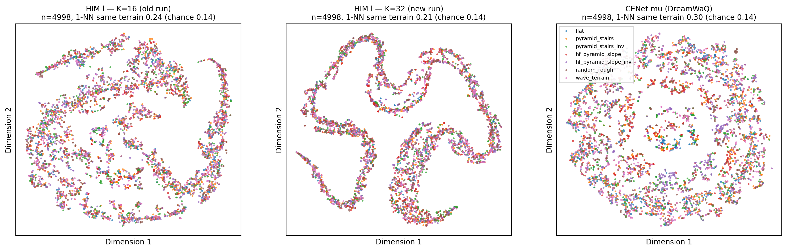

每类 714 点、共 4998 点，t-SNE（perplexity 30、750 次迭代）。三张图都是**颜色混合**
的连续流形，没有按地形分簇。

| latent | t-SNE 1-NN 同地形 | 16 维 1-NN 同地形 | 类间/类内中心距 | PC1 占比 | 参与率（有效维度） |
| --- | --- | --- | --- | --- | --- |
| HIM `l`，K=16（旧 run） | 0.238 | 0.260 | 0.102 | 85.8% | 2.71 |
| HIM `l`，K=32（新 run） | 0.207 | 0.228 | 0.063 | **97.7%** | **1.50** |
| CENet μ（DreamWaQ） | **0.296** | **0.302** | **0.154** | 43.6% | **3.74** |
| 随机基线 | 0.143 | 0.143 | — | — | — |

（"1-NN 同地形"= 每个点的最近邻是否与它同一种地形的比例；参与率 = (Σλ)²/Σλ²，
见文末名词表。）

## 2. 不经过 t-SNE 的 PCA：HIM 的 latent 是"准一维"的

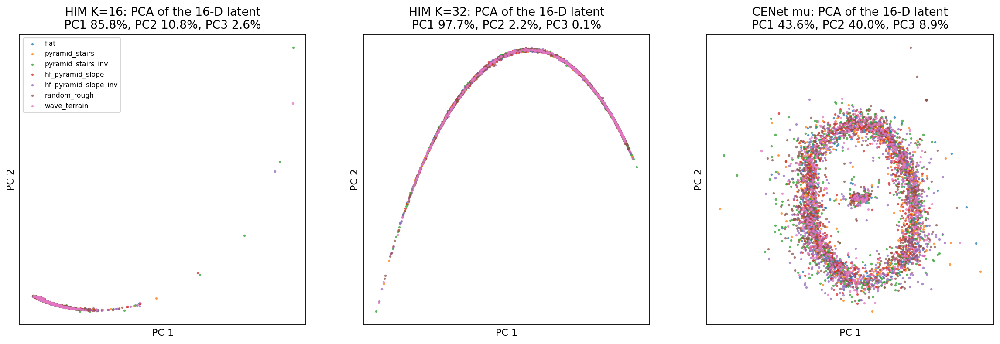

PCA（线性、不做非线性加工）显示：K=32 的 HIM latent 有 **97.7% 的方差集中在 PC1**，
有效维度 1.50 —— 所有样本几乎落在同一条曲线上；CENet 是真正的二维结构（43.6% + 40.0%）。
所以 t-SNE 的"环/长丝"不是算法伪影，而是**数据本身就低维**。而且维度越低，地形可分性越差
（CENet 3.74 > K16 2.71 > K32 1.50 对应 0.296 > 0.238 > 0.207）。

## 3. 按步态相位上色：形状 = 相位

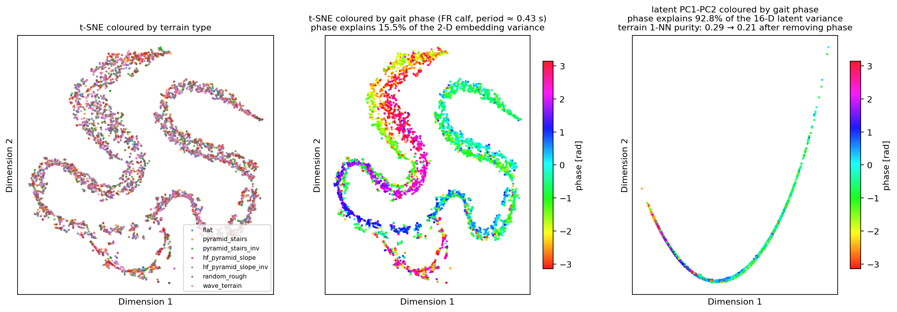

取第一条腿 calf 关节角做 Hilbert 变换得到瞬时步态相位（估计周期 **0.432 s**，≈2.3 Hz，
与 trot 相符）：

- 相位解释 HIM latent 方差的 **92.8%**，中图颜色沿长丝是完整的彩虹渐变；
- 左侧按地形上色依然是混的；
- 扣掉相位成分后，地形 1-NN 从 0.290 掉到 **0.208**（随机 0.143）——地形只剩很弱的残差。

**HIM 的 latent ≈ 步态相位的单值函数**，这就是"明显的形状"的含义。
它同时解释了另外两个现象：`him_swap_accuracy` 很高（相位极好预测），以及
1-NN 邻域绝大多数来自同一个环境（同一只狗 + 同一相位）。

### 3.1 "相位解释了 92.8% 的方差"具体怎么算、怎么读

手上有 4998 个样本，每个样本包含：

- 16 维 latent 向量 `l`（被解释的对象）；
- 该时刻的相位 `φ`（由 FR calf 关节角做 Hilbert 变换得到）。

用**一次谐波**（只知道"现在是周期第几拍"时能写出的最简单周期模型）去预测 latent：

```
l ≈ A·cos φ + B·sin φ + c
```

对 latent 的 16 个维度各拟合一组 (A, B, c)（最小二乘），得到预测 `l̂`，残差
`r = l − l̂`，然后：

```
R² = 1 − Σ‖r‖² / Σ‖l − mean(l)‖²
```

- **分子**：拟合后剩下、相位解释不了的变化量；
- **分母**：latent 本身的总变化量（每个样本相对平均 latent 的平方偏差，16 维合并）；
- **R² = 92.8%**：知道相位后，latent 的总变化只剩 7.2% 没被解释。

一个最小例子：三个值 `[1, 2, 3]`，均值 2，总变化 = 1² + 0² + 1² = 2。
模型完美预测 `[1,2,3]` → 残差 0 → R² = 100%；模型只会输出均值 `[2,2,2]` → R² = 0%。

读这个数时的四个要点：

1. 它是**方差（变化量）的解释比例**，不是准确率、也不是"有 92.8% 的维度在编码相位"；
2. 只用了 **cos/sin 一次谐波**；允许更高次谐波只会解释得更多，所以 92.8% 是保守下界；
3. 它说明"latent 的取值几乎由相位决定"（强关联），不是严格的因果结论；
4. 相位是从 FR calf 关节角算的，而这个关节角本身就在编码器的输入里——所以更准确的说法是
   "编码器把输入里最容易预测的周期信号学了过去"，这正是"相位捷径"。

对应的可视化是上面中间那张图（t-SNE 按相位上色）：颜色沿长丝是连续的彩虹渐变，
说明相邻位置主要由相位决定；右图 PC1-PC2 上相位是一条光滑曲线，也是同一个事实。

## 4. CENet 也大量编码相位，但它的地形成分更强

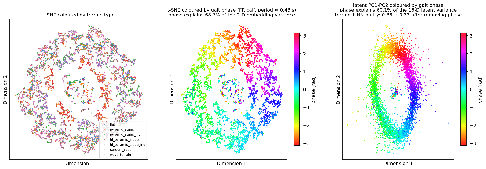

| 量 | HIM K=32 | CENet μ |
| --- | --- | --- |
| 相位解释的 latent 方差 | **92.8%** | **60.1%** |
| 相位解释的 t-SNE 嵌入方差 | 15.5% | 68.7%（圆环的走向就是相位） |
| 步态周期（Hilbert 估计） | 0.432 s | 0.432 s |

## 5. 把相位成分去掉 / 按环境平均：地形浮现出来了

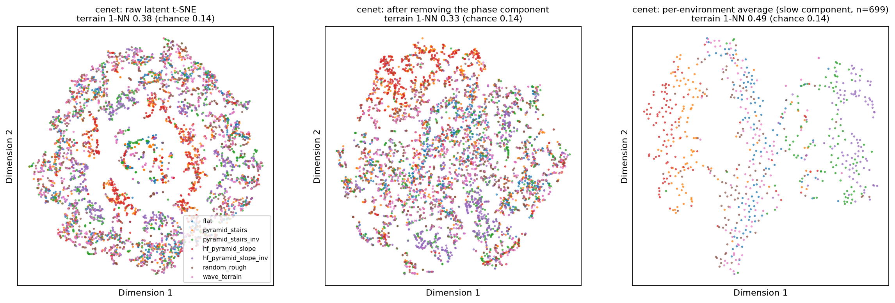
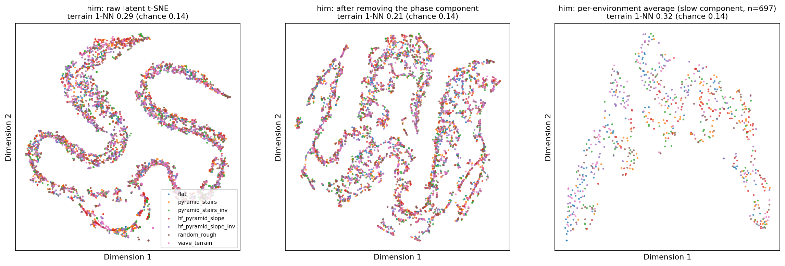

三栏分别是：原始逐帧 latent、去掉相位成分后的残差、每环境平均（慢变成分）——
三者都按地形上色：

| 口径（地形 1-NN 同地形比例） | HIM K=32 | CENet μ | 随机 |
| --- | --- | --- | --- |
| 原始（逐帧） | 0.290 | 0.377 | 0.143 |
| 去掉相位成分 | 0.208 | 0.334 | 0.143 |
| **每环境平均（慢变）** | 0.319 | **0.491** | 0.143 |

CENet 的右栏已经能看到明显的按地形分片（橙色 = 楼梯、红色 = 坡、紫/绿 = 反向地形等），
这正是论文 Fig. 4 那种"按地形成簇"的样子；HIM 的右栏也有结构但明显更弱。

### 5.1 怎么理解"每个环境的几百帧 latent 平均之后"

**"环境"是什么**：mjlab 同时跑 700 个独立的机器人（并行仿真）。每个机器人被固定安排
在**一种地形类型**上（例如 0 号在 flat、1 号在楼梯……），各自走约 5.7 秒（约 286 个
采样帧、约 13 个步态周期）。

**为什么要平均**：逐帧 latent 里 92.8%（HIM）/ 60.1%（CENet）是相位造成的。把一个
机器人 13 个周期的 latent 全部平均，相位会轮流经过 0~2π 的每个值——就像对一条完整的
正弦波求平均，正负相互抵消。剩下的是这个机器人在整段行走中**始终不变**的部分，也就是
慢变成分：它和"脚下是什么地形、动力学参数如何"有关。

**一个玩具例子**：两个机器人 A（flat）、B（楼梯），它们的 latent 可以近似写成

```
l_A(t) = phase_curve(t) + 地形偏移_A
l_B(t) = phase_curve(t) + 地形偏移_B
```

逐帧比较时，A 和 B 只要处在同一相位，距离就很近（相位项相同），所以最近邻很可能是
"同相位但不同地形"的点；把每个机器人的所有帧平均后，`phase_curve` 被抵消，只剩下
`地形偏移_A` 和 `地形偏移_B` —— 这时 A 的最近邻更可能是另一个 flat 机器人。

**数字怎么读**：每环境平均后只剩 697 个点（每个机器人一个点），对每个点找最近的另一个点，
看两者是否同地形：

- CENet：**0.491** —— 49% 的机器人最近邻是同地形，随机只有 1/7 = 14.3%，
  即 **3.4 倍随机**；图上右栏能直接看出橙色（楼梯）、红色（坡）、紫/绿（反向地形）
  各自成片。
- HIM：0.319（2.2 倍随机），结构更弱。

**注意**：① 平均会同时抹掉任何"每个 episode 内缓慢变化"的信息（例如速度漂移）；
这里每种地形在 episode 内固定，所以地形信息能保留下来。② 同一地形类型下不同机器人
站的是**不同的地形 patch**，还叠加了质量/摩擦等域随机化——这些都会让同地形点更分散，
所以 0.49 是偏保守的数字。③ 直方图/随机基线：700 个环境、7 类地形，各类约 100 个，
所以随机基线是 1/7。

## 6. 为什么"论文能估地形，我只能估相位"

按证据强弱排序：

1. **看的是哪个成分**（最直接的原因）。逐帧 latent 被相位主导（HIM 93%），地形信息在
   慢变成分里。第 5 节的"每环境平均"一栏说明：同一批数据换个聚合口径，CENet 的地形
   可分性就从 0.38 升到 0.49。论文那种"每种地形一团"的图，最可能是**每个环境/每段
   时间取一个点**（或等价地做了时间平均），而不是每一帧都画上——论文没有写采样口径，
   但这是与我们的数据最一致的解释。
2. **（仅作弱提示，不能当结论）地形响应可能偏弱**。在等级 3 + 1 m/s 下，我们对 12 个
   关节角做了两次**独立**的简单回归：

   | 观测（关节角）方差被解释的比例 | HIM 策略 | DreamWaQ 策略 |
   | --- | --- | --- |
   | 步态相位 | 35.3% | 50.2% |
   | 7 类地形（类均值） | **0.8%** | **0.8%** |

   这**只说明**："知道地形类型、取其平均关节角"这种最简单的分组模型，几乎解释不了
   关节角的变化——即不同地形下的**平均关节角**几乎没有差异。它**不能说明**：

   - 完整 45 维观测里没有地形信号（地形可能体现在投影重力、角速度、关节速度里）；
   - 关节角不含地形信息（可能存在"相同平均、不同分布"、与相位交互、时序模式等
     非线性/高阶关系，分组均值模型完全抓不到）；
   - 因此它**不能**作为"数据里没有可分的信号、对比学习必然学不到"的证据。

   要回答"有没有地形信号"，需要：完整观测逐通道分析、相位条件化（比较同一相位下的
   不同地形）、以及非线性探针（kNN/分类器交叉验证）——而不是只看关节角的分组均值。
   论文的训练地形是楼梯 5→23 cm、坡 0→40°、离散障碍 5→15 cm，并且课程会一直推到
   高难度；响应差异**可能**比等级 3 大得多，但这仍需要实测。
3. **奖励 → 行为 → 观测分布**（你提到的那条链）。latent 的辅助损失不直接看奖励，但
   它看的是"策略在什么状态间移动"。我们的奖励组合（pose/upright/foot_clearance/
   action_rate 等正则 + 训练只推进到等级 5~6）训出来的步态非常规整，周期性成分的
   方差压倒一切。至于论文的策略：它面对的楼梯/坡/障碍难度更大，**如果**它由此产生了
   更明显的抬腿/姿态/步频差异，那么地形响应就更强、可学的东西更多——但这一点同样
   需要实测（用完整观测 + 条件化探针），不能仅凭难度推断。
4. **对比学习的目标存在"相位捷径"**。优化目标是"预测后继状态的簇"，而相位是历史里
   最容易预测、方差又最大的成分——只要地形响应弱，最优解就是把所有维度都给相位。
   K=32（97.7% 方差集中在 PC1）就是这条捷径走到极端的表现。

一句话：**不是对比学习不行，而是"可学的地形信号"在我们这套设置里太小，同时"可学的
相位信号"太大；再叠加逐帧可视化口径，看到的就是一条相位曲线。**

## 7. 建议的下一步

1. **统一评估口径**：以后所有 latent 评估都用"每环境平均（或固定相位采样）"，
   否则看到的永远是相位；逐帧口径只用来诊断相位。
2. **把"地形信号强弱"测扎实**：① 记录完整 45 维观测，按通道（角速度/投影重力/
   关节位置/关节速度/动作/指令）分别做"相位解释 vs 地形解释"；② 地形项不要只用
   分组均值，至少做"相位条件化"（固定相位后比较地形）或非线性探针；③ 在等级
   5~8（必要时 1.5~2.0 m/s）重复。完成这些之后，"值不值得继续调 HIM"才有依据。
3. **训练侧堵捷径**（若要让 latent 真正编码环境）：
   ① 相位条件化（只在同相位样本间做对比，或先把相位回归掉再做 SwAV）；
   ② 对 latent 做去相关 / whitening，抑制单方向主导；
   ③ 目标改成"相位解释不了的残差响应"。另外先把 `proto_entropy/proto_active`
   两个失效指标修好（τ=3 下它们恒为常数），不然看不清对比学习本身的状态。
4. **策略是否用到了那点残差**：做消融——把 latent 的相位成分置零 vs 把残差置零，
   看行走性能掉多少。如果策略只靠相位，那当前实现实质上是"相位编码器 + 策略"。

## 8. 把评估地形从 level 3 提到 level 5

动机：两次训练结束时平均地形等级都在 ~5.5，level 3（台阶约 6.7 cm、坡约 13°）可能
太简单，地形在观测里的"指纹"偏弱。于是在 **level 5**（台阶约 11 cm、坡约 21°）用
完全相同的协议复测（700 环境 × 约 5.7 秒、每类 714 点、4998 点，t-SNE 750 次迭代）：

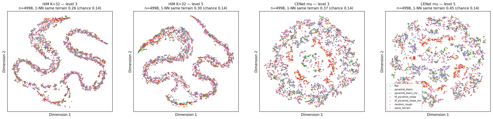

| 指标 | HIM K=32 L3 | HIM K=32 L5 | CENet L3 | CENet L5 |
| --- | --- | --- | --- | --- |
| t-SNE 1-NN 同地形 | 0.256 | **0.298** | 0.368 | **0.445** |
| 16 维 1-NN 同地形 | 0.290 | **0.331** | 0.377 | **0.463** |
| 类间/类内中心距 | 0.040 | **0.129** | 0.244 | **0.420** |
| 相位解释 latent 方差 | 92.8% | 92.9% | 60.1% | **43.0%** |
| 去掉相位后的 1-NN | 0.208 | **0.260** | 0.334 | **0.417** |
| 每环境平均后的 1-NN | 0.319 | **0.454** | 0.491 | **0.562** |
| 步态周期 | 0.432 s | 0.477 s | 0.432 s | 0.457 s |
| 随机基线 | 0.143 | 0.143 | 0.143 | 0.143 |

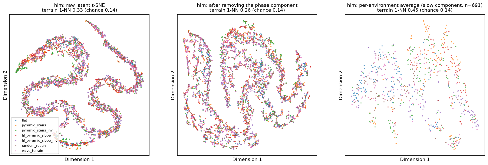
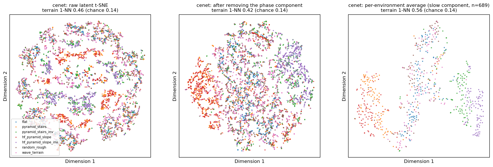

CENet level 5 的"每环境平均"单独放一张（n=689，地形 1-NN **0.562**，随机 0.143）：

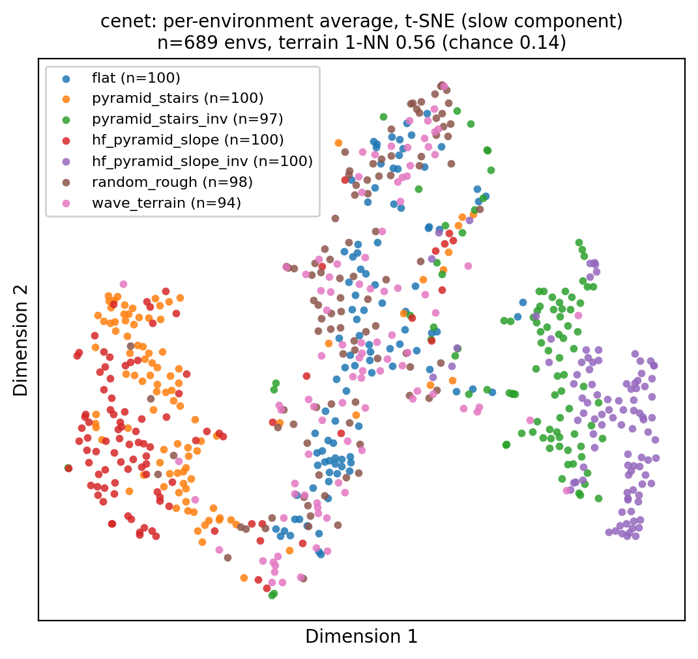

**结论**：

1. **难度提高后，两边都更按地形组织了**（所有可分性指标上升，且幅度不小），支持
   "评估地形太简单"是之前聚类不明显的原因之一。
2. HIM 在 level 5 的**逐帧** latent 仍近乎纯相位（92.9%），但它的**慢变成分**明显变强：
   每环境平均 0.319 → **0.454**（3.2 倍随机），去相位后的 1-NN 也从 0.208 升到 0.260。
3. CENet 在 level 5 的相位占比从 60.1% 降到 **43.0%**，慢变成分达到 **0.562**
   （3.9 倍随机）；它的 t-SNE 图上已经能看出较明显的色块（红/蓝/紫各成片）。
4. 步态周期从 0.43 s 放慢到 0.46~0.48 s，说明策略在难地形上确实改变了步态——
   这是"地形响应变强"的间接证据（但仍是间接的，严格检验见 §6）。
5. 局限：只测了 level 3 和 5 两个点，且是同一 checkpoint 在两种难度上的评估；
   要画趋势应补 level 1/3/5/7/9，并配合完整观测的相位条件化探针。

## 9. 原版 Isaac Gym HIMLoco 的对照（2026-10-17）

用原版代码训练到 **2040 轮**的 Go1 checkpoint（`rough_go1/Oct17_13-23-50_/model_2040.pt`），
按同样协议在 **level 5** 评估：700 环境、约 5.7 秒、每帧取 `estimator.encode` 的 16 维
`z`。地形按 legged_gym 的 `curriculumn` 列布局分成 **4 类粗地形**
（slope / rough_slope / stairs / discrete，stairs 合并上下行），每类均衡 1250 点。

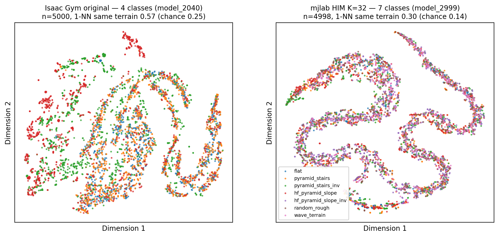

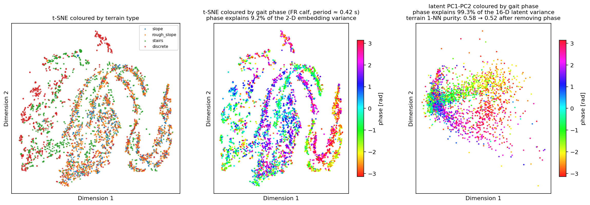
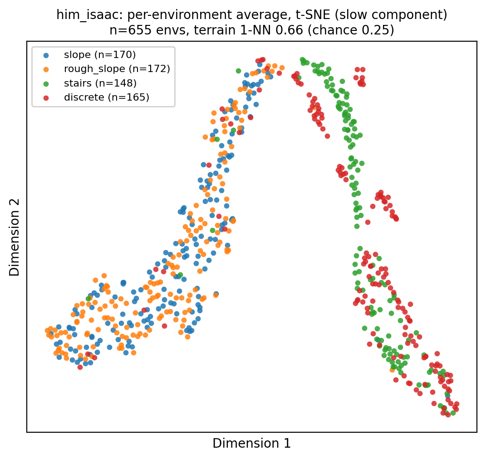

| 指标 | Isaac 原版（4 类） | mjlab HIM K=32（7 类） |
| --- | --- | --- |
| 相位解释 latent 方差 | **99.3%** | 92.9% |
| t-SNE 1-NN 同地形 | 0.566（**2.26×** 随机） | 0.298（**2.08×**） |
| 16 维 1-NN 同地形 | 0.577（**2.31×**） | 0.331（**2.32×**） |
| 类间/类内中心距 | 0.576 | 0.129 |
| 去掉相位后的 1-NN | 0.523（**2.09×**） | 0.260（**1.82×**） |
| 每环境平均后的 1-NN | 0.661（**2.64×**） | 0.454（**3.18×**） |
| PC1 / 参与率 | 98.5% / 1.90 | 97.0% / 1.62 |
| 步态周期 | 0.424 s | 0.477 s |
| 评估中摔倒环境数 | 181 / 700 | 25 / 700 |
| 随机基线 | 0.25 | 0.143 |

**结论**：

1. **"原版学地形、我们只学相位"这个前提不成立**：原版 latent 的相位解释率是 **99.3%**，
   比 mjlab 的 92.9% 还高——两者都是"相位编码器"。原版之所以在 t-SNE 上看起来更按
   地形分，是因为它的**极小非相位残差（0.7% 方差）里地形结构更干净**，而 t-SNE 会
   放大这个小残差。
2. 绝对数字上原版更高（0.566/0.577 vs 0.298/0.331），但随机基线不同（4 类 0.25 vs
   7 类 0.143）。按"相对随机"归一后，逐帧可分性几乎一样（2.26×/2.31× vs 2.08×/2.32×）。
3. 原版的去相位残差更强（2.09× vs 1.82×），说明"地形信息集中在很小的非相位子空间"
   这一点上原版确实更好；但在**慢变成分（每环境平均）**上，mjlab 反而更强
   （3.18× vs 2.64×）。
4. 视觉差异还有两个"口径"原因：a) 原版只有 **4 类粗地形**，而且包含非常独特的
   **discrete obstacles**（图上方那团红色孤立簇），我们把上下行楼梯和正反坡都拆成
   独立类，类别更细、更难在图上成簇；b) 原版评估中 181/700 环境摔倒（mjlab 只有
   25/700），步态周期也不同（0.424 vs 0.477 s），说明两个策略的行为分布本身有差异
   （训练轮数、奖励、机器人/物理都不同）。
5. 因此：**mjlab 移植没有把 HIM "写坏"成只学相位**——原版也这样；真正的差异在
   "非相位残差的质量"和"地形类别定义/行为分布"。下一步应做同类别子集（slope /
   rough / stairs 三类）的同口径对比，并在 level 7~9 上重复，才能把类别定义的影响
   剥离出去。

## 附：名词表

- **t-SNE**：非线性降维，把高维点映到 2 维，**只保邻域关系**；点的绝对距离、簇的大小
  没有意义，形状（丝/环）会被算法放大。
- **PCA（主成分分析）**：线性降维。把坐标轴旋转到"方差最大"的方向：PC1 是数据变化
  最大的方向，PC2 是剩下里最大的，依此类推。它不加工形状，所以能直接回答"数据是不是
  低维"。
- **参与率 = (Σλ)² / Σλ²**（λ 为 PCA 各主成分方差）：有效维度。方差平均摊在 d 个方向
  时等于 d；全集中在一个方向时等于 1。
- **1-NN（最近邻）同 X 比例**：每个样本在某个空间里找最近的那个点，看它是否与查询点
  有相同的 X（地形类型 / 环境编号）。随机基线 ≈ X 的类占比（同地形 1/7 = 0.143，
  同环境 1/700 ≈ 0.0014）。"比随机高几倍"衡量该空间是否真的按 X 组织。
- **相位残差**：把 latent 对 [cos φ, sin φ] 做最小二乘回归后剩下的部分，即"相位解释
  不了"的成分。
- **环境平均（慢变成分）**：每个并行环境把几百帧 latent 平均，周期性成分在多个步态
  周期上相互抵消，剩下的是随地形/动力学缓慢变化的成分。
