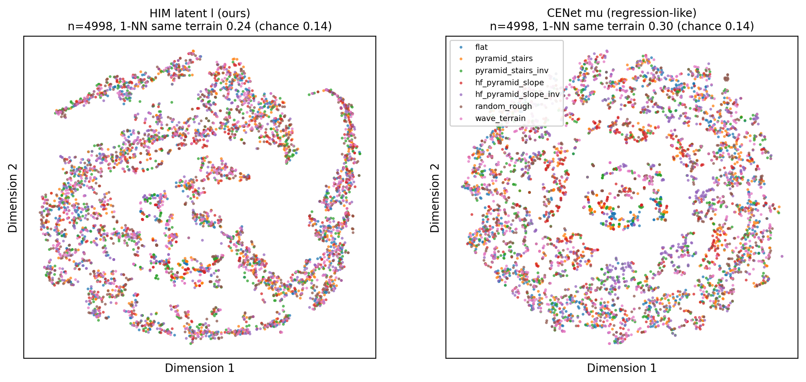
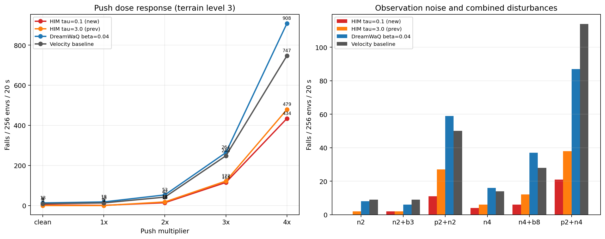

# HIM 复现实验记录

本文件记录 HIM 在 mjlab 的复现实验。方案见 `../复现方案/实施方案.md`，
口径差异见 `../复现方案/论文未明确之处.md`。

> latent 相关的结论已整理成独立文档：**《latent 到底编码了什么：地形，还是步态相位？》**
> （`latent地形与相位分析.md`，含全部图与数字）。
>
> **2026-10-17 指标修正**：旧版相位 R² 使用未中心化分母，且有效维度误用了奇异值。
> 下文相位 R²、PCA 有效维度及相关结论已重算；地形 1-NN 与相位残差数值不变。

---

## 0. 冒烟验证（2026-10-16）

**目的**：验证接入链路（env → RolloutStorage → 估计器 → HimPPO → 检查点 / ONNX）
端到端可用，不用于评价训练效果。

**命令**（本机沙箱内无 GPU，`--gpu-ids None` 走 CPU）：

```bash
uv run train Mjlab-HIM-Rough-Unitree-Go1 \
  --gpu-ids None --env.scene.num-envs 64 --agent.max-iterations 2 \
  --agent.logger tensorboard
```

**结果**（`logs/rsl_rl/go1_himloco/2026-10-16_17-59-57`）：

| 标量 | iter 0 | iter 1 |
| --- | --- | --- |
| `Loss/him_est` | 0.1817 | 0.2125 |
| `Loss/him_swap` | 0.1730 | 0.1729 |
| `Loss/him_total` | 0.3547 | 0.3853 |
| `Loss/value` | 0.0204 | 0.0236 |
| `Metrics/him_vel_error` (m/s) | 0.4150 | 0.3606 |

- `Metrics/him_proto_active = 16`、`Metrics/him_proto_entropy = 0.9997`：2 次更新后原型
  没有被少数原型吃掉；`Metrics/him_swap_accuracy = 0.084`（初始值，训练久了才有意义）。
- 检查点 `model_0.pt` / `model_1.pt` 正常写出，ONNX 导出成功：
  输入 `obs_history (1, 270)` → 输出 `actions (1, 12)`，onnxruntime 前向通过。
- 单测 12 项 + 任务配置 9 项通过；`ruff check` 通过，`ty` 仅剩
  `dreamwaq/doc/实验/实验数据/stress_test/stress_eval.py` 的既有告警（与本次改动无关）。

**尚未做**：4096 envs × 600 迭代的正式训练（需要 GPU 机器），以及
`论文未明确之处.md` 中列为"后续可选"的对照与消融。

## 0.1 Black 冒烟验证（2026-10-16）

```bash
uv run train Mjlab-HIM-Rough-Black \
  --gpu-ids None --env.scene.num-envs 32 --agent.max-iterations 2 \
  --agent.logger tensorboard
```

- 观测组形状与 Go1 一致：`him_input (6, 45)`、`him_state (45,)`；
- iter 0/1：`Loss/him_est` 0.1634 / 0.2045，`Loss/him_swap` 0.1726，
  `Metrics/him_vel_error` 0.3789 → 0.3644 m/s，原型 16 个全活跃、熵 0.9997；
- 检查点与 ONNX 正常（输入 `obs_history (1, 270)` → 输出 `actions (1, 12)`，onnxruntime 前向通过）。

`Mjlab-HIM-Flat-Black` 只做了配置加载验证（观测组、play 模式、episode 长度），未跑训练。

---

## 1. latent t-SNE 评估（地形可分性，2026-10-16）

**目的**：回答"训练曲线之外的直接问题"——隐向量 `l` 到底有没有能力区分地形。
训练曲线里只有 `Metrics/him_swap_accuracy` 能间接反映"两路对情形判断一致"（本次 run
后期 ~0.87，随机基线 1/16=0.0625），但它证明不了"一致的那个情形就是地形"。

**方法**（脚本 `实验数据/tsne_latent.py`、对比图 `实验数据/tsne_compare.py`）：

- 两条臂各取各自 run 的最终 checkpoint：
  HIM = `logs/rsl_rl/go1_himloco/2026-10-16_18-49-56/model_2999.pt`（3000 轮）；
  CENet = `logs/rsl_rl/go1_dreamwaq/2026-10-12_16-06-44/model_599.pt`（β=0.04 那一条，
  论文 Fig. 4(b) "regression" 的对应物）；两者 env/地形/奖励完全相同，只换观测组；
- 训练版 rough 地形（`curriculum=True`，每种地形恰好一列），**所有环境钉在等级 3**，
  地形类型按 `env_idx % 7` 均匀分配；观测噪声、推力事件关掉；
- 固定前进指令 1.0 m/s，先跑 60 步热身，再采样 800 步；
- 每个采样步取 Actor 前向里缓存的隐向量（HIM: `l̂`，CENet: 后验均值 μ），
  摔倒环境永久剔除（自动重置会重新随机地形类型，标签不可信）；
- 每类均匀下采样 714 点（共 4998）→ 自研精确 t-SNE（float64，perplexity 30、
  early exaggeration 12 × 250 步、750 次迭代；HIM KL 2.98→0.81，CENet 3.47→1.04）。

**命令**：

```bash
# HIM 与 CENet 各跑一次（700 环境 × 800 步，约 5 分钟/条）
uv run python src/mjlab/tasks/himloco/doc/实验/实验数据/tsne_latent.py --latent him --level 3
uv run python src/mjlab/tasks/himloco/doc/实验/实验数据/tsne_latent.py --latent cenet --level 3
# 论文 Fig. 4 风格的双联对比图
uv run python src/mjlab/tasks/himloco/doc/实验/实验数据/tsne_compare.py \
  src/mjlab/tasks/himloco/doc/实验/实验数据/tsne_him_k16_model_2999_L3.npz \
  src/mjlab/tasks/himloco/doc/实验/实验数据/tsne_cenet_model_599_L3.npz \
  --out src/mjlab/tasks/himloco/doc/实验/实验数据/tsne_him_vs_cenet_L3.png
```

**结果**（n=4998，每类 714 点；随机基线 1/7 = 0.143）：



| 指标 | HIM `l̂` | CENet μ | 随机基线 |
| --- | --- | --- | --- |
| 2-D t-SNE 中 1-NN 同地形比例 | 0.238 | **0.296** | 0.143 |
| 2-D t-SNE 中 1-NN 同环境比例 | 0.077 | 0.080 | ≈0.002（1/700） |
| 原始 16 维 latent 的 1-NN 同地形比例 | 0.260 | **0.302** | 0.143 |
| 类间中心距 / 类内平均距 | 0.102 | **0.154** | — |

两边的图都是**颜色混合的连续流形**，没有出现论文 Fig. 4 那种"按地形成簇"的结构；
按三个口径（t-SNE 1-NN、16 维 1-NN、类间/类内中心距）**CENet 都略好于 HIM**。

**结论**：

1. 在等级 3、固定 1 m/s 指令下，**两条 latent 都基本不按地形类型分簇**（各约 1.7~2.1
   倍随机），而且"同一环境/同一段轨迹"的聚集倾向（0.077/0.080）比"同地形"强得多——
   邻近点更多是同一段轨迹，而不是同一种地形。
2. 与训练曲线不矛盾：`him_swap_accuracy ≈ 0.87` 只说明"历史能预测后继状态的簇"，
   这个被稳定预测的"情形"更像**步态相位/身体状态这类快变量**。
3. **与论文 Fig. 4 的方向相反**：论文里 HIM 的 latent 比 regression（DreamWaQ 系）
   分得更开，这里用加大样本量（5000 点）复测，CENet 反而略好。差异可能来自地形集合
   （我们 7 类、含 flat 与两个方向的坡）、单一难度、固定指令、单 seed、以及
   mjlab 与 Isaac Gym 的实现差异；需要后续（多等级/多指令/多 seed、线性探针）再判。
4. 至少说明：**当前这两个 latent 都不能拿来当"地形分类器"用**，不能用它们给
   "HIM 学到了地形"背书。

**后续（按性价比排序）**：

1. `--level 1/5` 各跑一次：看地形越难/越易时可分性是否变化；
2. `--command-x -1`（用环境自身的随机指令）或换几个固定速度：排查"指令恒定 → latent
   主要在编码步态"这一混淆；
3. 把线性探针（logistic regression / kNN 交叉验证）加进脚本，给出比 1-NN 更稳的
   "地形可分性"数值；
4. 换 seed / 换 checkpoint（比如 1500 轮 vs 2999 轮）复测，确认"两边都不分地形"不是
   单次采样或单点 checkpoint 的偶然；
5. 若确认 latent 不编码地形，回到训练侧排查：原地形集合是否太大（7 类、含 flat 与
   pyramid 反向类）、`temperature=3` 是否让对比目标过软、是否需要 `latent_spread/drift`
   这类诊断指标。

---

## 2. 新 run（K=32 + foot_clearance=-2.0）复测（2026-10-17）

**run**：`logs/rsl_rl/go1_himloco/2026-10-16_22-19-10`（3000 轮，22:19 → 00:36，
最终 checkpoint `model_2999.pt`）。与第 1 节的旧 run 逐项 diff `params/` 后，只有两处不同：

- `model.him_cfg.num_prototypes: 16 → 32`（上一轮讨论的"对齐官方代码"改动）；
- `rewards.foot_clearance.weight: 0.0 → -2.0`（之前被设为 0 的那项奖励重新打开）。

**方法**：与第 1 节完全一致（`--latent him --level 3`，700 环境 × 800 步、
每类 714 点、n=4998、t-SNE 750 次迭代，KL 2.58→0.71）。


| latent | t-SNE 1-NN 同地形 | t-SNE 1-NN 同环境 | 16 维 1-NN 同地形 | 类间/类内中心距 |
| --- | --- | --- | --- | --- |
| HIM `l̂`，K=16（旧 run） | 0.238 | 0.077 | 0.260 | 0.102 |
| HIM `l̂`，K=32（新 run） | **0.207** | 0.052 | **0.228** | **0.063** |
| CENet μ（DreamWaQ） | **0.296** | 0.080 | **0.302** | **0.154** |
| 随机基线 | 0.143 | ≈0.0014 | 0.143 | — |

**训练曲线对比（窗口 2500–2999，同口径指标）**：

| 指标 | K=16 旧 run | K=32 新 run |
| --- | --- | --- |
| `Episode_Reward/track_linear_velocity` | 1.306 | 1.243 |
| `Metrics/twist/error_vel_xy` | 0.591 | 0.643 |
| `Curriculum/terrain_levels/mean` | 5.59 | 5.41 |
| `Train/mean_episode_length` | 907.5 | 899.5 |
| `Episode_Termination/illegal_contact` | 0.796 | 0.859 |
| `Metrics/him_swap_accuracy` | 0.860 | 0.873 |
| `Metrics/him_vel_error`（m/s） | 0.1248 | 0.1196 |
| `Loss/him_swap` | 0.160 | 0.102 |

（`Train/mean_reward` 不在此表：新 run 改了奖励权重，总回报不可直接比较。）

**结论**：

1. 新版（K=32 + foot_clearance 恢复）在**三个地形可分性口径上全部变差**：
   0.207 / 0.228 / 0.063，均低于旧版（0.238 / 0.260 / 0.102）；CENet（0.296 / 0.302 /
   0.154）仍是三者中最高。三张图都还是"颜色混合的连续流形"。
2. 训练侧同步略退化（速度跟踪 -5%、`error_vel_xy` +9%、地形等级 -0.18），
   而 HIM 自身的指标略好（`swap_accuracy` +0.013、`vel_error` -0.005 m/s、
   `Loss/him_swap` -36%）——即"伪标签更细/更自信"没有转化成"latent 更像地形"。
3. 这次同时改了 K 与奖励，**不能把差异单独归因于 K**；但可以确定：这两个改动都没有
   让 latent 更接近"地形分类器"，也没有复现论文 Fig. 4(a) 的按地形分簇。
4. 下一步建议：先把 §1 后续清单里的"线性探针 + 多等级/多指令 + 多 seed"做完，
   再决定是否继续在 K / τ / 地形集合上做训练侧消融。

### 2.1 为什么 t-SNE 出来是个"环/长丝"：PCA 交叉验证（2026-10-17）

t-SNE 的形状容易被误读（拉长、成环、成丝）。为了排除"形状只是 t-SNE 伪影"，对同一批
16 维 latent 直接做了 PCA（不经过 t-SNE）：


| latent | PC1 | PC2 | PC3 | 有效维度（参与率 (Σλ)²/Σλ²） |
| --- | --- | --- | --- | --- |
| HIM `l̂` K=16 | 85.8% | 10.8% | 2.6% | 1.33 |
| HIM `l̂` K=32 | **97.7%** | 2.2% | 0.1% | **1.05** |
| CENet μ | 43.6% | 40.0% | 8.9% | 2.75 |

结论：

1. K=32 的 HIM latent 实际上是**准一维的**（PC1 一个人吃掉 97.7% 方差，参与率 1.05）：
   所有样本几乎落在同一条曲线上，t-SNE 只是把这条一维流形拉长、卷成了环/长丝。
   所以"明显的形状"本身**不是**地形结构，而是"表示坍缩到一个主导方向"的表现。
2. K=16 是 1 维（85.8%）+ 一点第二方向；CENet 的有效维度为 2.75，主流形接近二维
   （43.6% + 40.0%）。
   这与地形可分性的排序一致（CENet 0.296 > K16 0.238 > K32 0.207）：**latent 的
   有效维度越低，地形信息越少**。
3. 结合 §1 的现象（最近邻绝大多数来自同一段轨迹，而不是同一种地形），这个主导方向
   更可能是轨迹/运动状态变量，而不是环境属性；但它是否就是步态相位需要单独检验。
4. §2.2 的检验表明相位一次谐波只解释 41.3% 的中心化 latent 方差，因此不能把整个
   主导方向直接等同于相位。相位仍是需要控制的协变量，但"相位捷径吞掉全部容量"尚未
   被证实。

### 2.2 按步态相位上色：相位与形状有关，但只解释约四成（2026-10-17）

**方法**（脚本 `实验数据/phase_check.py`，数据 `--store-raw` 密集采集，20 万原始样本）：

- 采样时每个控制步都记录 12 个关节角与足端接触/腾空时间；
- 取第一条腿 calf 关节（关节 2）的连续角度序列做 Hilbert 变换 → 瞬时步态相位；
- 把相位按 (env_id, step) 映射回 t-SNE 用的 4998 个点，然后：t-SNE 按地形上色、
  t-SNE 按相位上色、latent PC1-PC2 按相位上色；
- 量化：相位对 latent 的方差解释率 R²（latent 对 [cos φ, sin φ] 回归，分母为中心化
  方差），以及"原始 / 去掉相位成分后"的地形 1-NN 可分性。


**结果**（K=32 新 run，等级 3，固定 1 m/s）：

| 量 | 值 |
| --- | --- |
| 步态周期（FR calf Hilbert 相位） | **0.432 s**（≈2.3 Hz，与 trot 相符） |
| 相位解释的 latent 方差 | **41.3%**（20 次谐波为 45.3%） |
| 相位解释的 t-SNE 嵌入方差 | 15.5%（环的**走向**由相位决定，见中图彩虹渐变） |
| 地形 1-NN 可分性（原始） | 0.290（随机 0.143） |
| 地形 1-NN 可分性（去掉相位成分） | 0.208（随机 0.143） |

**结论**：

1. 中图的局部颜色会沿轨迹变化，但不同分支会重复出现相同颜色；一次谐波只解释 41.3%
   的中心化方差（20 次谐波为 45.3%），所以不能把 PC1-PC2 的曲线直接称为"相位曲线"。
2. 相位残差约占 58.7% 的总方差；残差上的地形 1-NN 为 0.208（随机 0.143），仍是弱信号。
3. `him_swap_accuracy ≈ 0.87` 只说明后继状态可预测，不能证明可预测变量就是相位。
   "相位捷径"仍是待验证假设，不应再用旧版 92.8% 支持它。

**训练侧含义（待验证）**：若想让 latent 真的编码环境，可以尝试抑制低维快变方向，例如：
① 把相位作为已知量条件化（对比目标在"同相位"样本间做，或回归相位后再对比）；
② 对 latent 做去相关/whitening，抑制单方向主导；③ 目标改成"相位解释不了的残差响应"。
这些改动是否有效，取决于策略实际使用了多少相位；当前 R² 不足以单独回答。

---

## 3. 相位分解与 CENet 对照（2026-10-17）

**问题**：① CENet 是不是也在编码相位？② 把相位成分去掉后，剩下的 latent 能不能按地形
聚类？③ 为什么原版论文的地形结构更清楚，而本次 HIM 的逐帧地形较弱？

**方法**（脚本 `实验数据/phase_check.py`、`实验数据/latent_decompose.py`）：

- `--store-raw` 密集采集（每控制步、700 环境、约 20 万样本），Hilbert 相位；
- 三种口径：**原始逐帧** / **去掉相位成分（latent 对 [cos φ, sin φ] 回归的残差）** /
  **每环境平均（慢变成分）**；
- 另做观测层面的方差分解：12 个关节角分别对相位、对 7 类地形均值回归。

**结果**（地形 1-NN 同地形比例，随机 0.143）：

| 口径 | HIM K=32 | CENet μ |
| --- | --- | --- |
| 原始逐帧 | 0.290 | 0.377 |
| 去掉相位成分 | 0.208 | 0.334 |
| **每环境平均（慢变）** | 0.319 | **0.491** |

| 量 | HIM K=32 | CENet μ |
| --- | --- | --- |
| 相位解释的 latent 方差 | 41.3% | **60.1%** |
| 相位解释的 t-SNE 嵌入方差 | 15.5% | 68.7% |
| 步态周期（Hilbert 估计） | 0.432 s | 0.432 s |

观测层面（**仅 12 个关节角**，两次独立回归）：相位解释 **35.3%**（HIM 策略）/
**50.2%**（DreamWaQ 策略）的方差；而"按 7 类地形取平均关节角"只解释 **0.8%**。
注意：这只说明关节角的**分组均值**几乎没有地形差异，**不能**说明完整 45 维观测里
没有地形信息（投影重力/角速度等通道未测），也不能排除关节角与相位耦合的非线性关系。

**结论**：

1. **CENet 的相位解释率高于 HIM**（60.1% vs 41.3%）；三个口径上它的地形可分性都更高，
   而且按环境平均后达到 **0.491（3.4 倍随机）**，图上已经能看到按地形分片——这就是
   论文 Fig. 4 那种"按地形成簇"的样子。
2. **HIM K=32 是准一维表示，但不是纯相位编码器**（相位 41.3%）；地形信息更多存在于
   慢变残差里，且很弱（0.319）。逐帧图上颜色混合主要说明快变轨迹结构压过了地形。
3. **为什么论文能、这里不能**（按证据强弱）：
   ① 论文那种图**最可能**用的是"每环境/每段时间取一个点"的慢变口径，逐帧口径会被
   快变轨迹结构主导（论文未写采样口径）；② 奖励塑造步态 → 观测分布，规整轨迹让少数
   低维方向占据大部分方差；③ 相位可能是对比学习的捷径之一，但当前证据还不足以证明；
   ④ 地形响应的强弱尚**未被严格测量**：目前只有"关节角分组均值只解释 0.8%"这个
   单通道、线性模型的结果，只能作为弱提示，不能当作"观测里没有地形信号"的证据。
4. **后续评估口径**应统一为"每环境平均 / 固定相位采样"；并在更高等级（5~8）重做方差
   分解——但要改用**完整 45 维观测、逐通道、相位条件化/非线性探针**，而不是只看
   关节角分组均值；完成之后再决定是否继续调 HIM。

完整图与通俗解释见独立文档 **`latent地形与相位分析.md`**。

---

## 4. 提高评估地形到 level 5（2026-10-17）

**动机**：两次训练结束时平均地形等级约 5.5；level 3（台阶约 6.7 cm、坡约 13°）偏简单，
地形在观测里的信号可能太弱。按同一协议（700 环境 × 约 5.7 s、每类 714 点、4998 点，
t-SNE 750 次）在 **level 5**（台阶约 11 cm、坡约 21°）复测 HIM K=32 与 CENet。


| 指标 | HIM L3 | HIM L5 | CENet L3 | CENet L5 |
| --- | --- | --- | --- | --- |
| t-SNE 1-NN 同地形 | 0.256 | **0.298** | 0.368 | **0.445** |
| 16 维 1-NN 同地形 | 0.290 | **0.331** | 0.377 | **0.463** |
| 类间/类内中心距 | 0.040 | **0.129** | 0.244 | **0.420** |
| 相位解释 latent 方差 | 41.3% | 37.4% | **60.1%** | 42.6% |
| 去相位后的 1-NN | 0.208 | **0.260** | 0.334 | **0.417** |
| 每环境平均后的 1-NN | 0.319 | **0.454** | 0.491 | **0.562** |
| 步态周期 | 0.432 s | 0.477 s | 0.432 s | 0.457 s |

分解图：`实验数据/tsne_him_k32_L5_decompose.png`、
`实验数据/tsne_cenet_L5_decompose.png`；CENet L5 每环境平均的单图：
`实验数据/tsne_cenet_L5_envmean.png`（n=689，地形 1-NN 0.562，随机 0.143）。

**结论**：

1. **提高地形难度后，两边都更按地形组织**（所有可分性指标上升），"评估地形太简单"
   确实是之前聚类不明显的原因之一。
2. HIM 的逐帧 latent 仍准一维，相位解释率从 41.3% 降到 **37.4%**；慢变成分明显变强：
   每环境平均 0.319 → **0.454**（3.2 倍随机）。
3. CENet 在 level 5 相位解释率降到 **42.6%**，仍高于 HIM；每环境平均达到 **0.562**
   （3.9 倍随机），是当前最"地形化"的表示。
4. 步态周期从 0.43 s 放慢到 0.46~0.48 s，说明策略在难地形上改变了步态（间接证据）。
5. 局限：只有 level 3/5 两个点；下一步补 level 1/3/5/7/9 的趋势与完整观测探针。

---

## 5. 原版 Isaac Gym HIMLoco 对照（2026-10-17）

原版代码没有 t-SNE 脚本，因此新写了 `~/桌面/quadruped/analysis/extract_isaac_himloco.py`
（Isaac Gym 侧提取 latent + 地形标签 + 关节角），分析仍复用 mjlab 的 t-SNE/相位/分解脚本。

- checkpoint：`legged_gym/logs/rough_go1/Oct17_13-23-50_/model_2040.pt`（2040 轮）；
- 协议：level 5、700 环境、约 5.7 s，每帧取 `estimator.encode` 的 16 维 `z`；
- 地形：legged_gym 的 4 类粗地形（slope / rough_slope / stairs / discrete），
  每类均衡 1250 点；181/700 环境摔倒被剔除。


| 指标 | Isaac 原版（4 类） | mjlab HIM K=32（7 类） |
| --- | --- | --- |
| 相位解释 latent 方差 | **19.6%** | 37.4% |
| t-SNE 1-NN 同地形 | 0.566（2.26×随机） | 0.298（2.08×） |
| 16 维 1-NN 同地形 | 0.577（2.31×） | 0.331（2.32×） |
| 类间/类内中心距 | 0.576 | 0.129 |
| 去掉相位后的 1-NN | 0.523（2.09×） | 0.260（1.82×） |
| 每环境平均后的 1-NN | 0.661（2.64×） | 0.454（3.18×） |
| PC1 / 有效维度 | 98.5% / 1.03 | 97.0% / 1.06 |
| 步态周期 | 0.424 s | 0.477 s |

**结论**：

1. 原版也是**准一维**，但相位解释率只有 **19.6%**，低于 mjlab 的 37.4%——"原版学地形、
   mjlab 只学相位"的前提不成立，但原因不是原版也几乎只学相位。差异在原版非相位部分
   的地形结构更干净，以及地形类别更粗（4 类，含非常独特的 discrete obstacles）。
2. 按随机基线归一后，逐帧可分性几乎相同（2.26×/2.31× vs 2.08×/2.32×）；慢变成分上
   mjlab 反而略强（3.18× vs 2.64×）。
3. 两个策略的行为差异明显（181 vs 25 次摔倒、周期 0.424 vs 0.477 s），所以还需
   同类别子集（slope/rough/stairs）+ 更高难度的同口径对比。

完整图与解释见 `latent地形与相位分析.md` §9。

---

## 6. 抗干扰压力测试（2026-10-18）

**对象**：

- HIM `temperature=0.1`、3000 轮：
  `2026-10-17_18-49-36/model_2999.pt`；
- HIM `temperature=3.0`、3000 轮：
  `2026-10-16_22-19-10/model_2999.pt`；
- 历史 DreamWaQ 主配置 `D det beta=0.04`、速度基线：
  直接使用 `dreamwaq/doc/实验/实验数据/stress_test/results.json` 的 level 3 记录。

**协议**：与历史 DreamWaQ 压力测试一致，地形固定 level 3，256 环境，每格 1000 个
50 Hz 控制步（20 s），seed `20261012`；关闭环境自带噪声和 push，手动注入配对扰动：

- push：每 1 s 施加一次世界系速度踢，强度从训练档的 1× 到 4×；
- observation noise：对 actor 与 HIM 六帧历史加白噪声，2×/4×；
- encoder bias：恒值关节位置编码器偏置，3×/8×；
- 统计 `illegal_contact` 终止次数，折算为每 256 环境 / 20 s。

两个 HIM checkpoint 分别使用训练时的观测尺度评估：τ=0.1 使用官方缩放，τ=3 恢复旧原始
尺度；观测噪声也按各自训练档换算。推力和地形物理参数保持相同。

**结果**（摔倒次数 / 256 envs / 20 s）：

| 扰动 | HIM τ=0.1 | HIM τ=3 | DreamWaQ β=0.04 | 速度基线 |
| --- | ---: | ---: | ---: | ---: |
| clean | 3 | **0** | 13 | 9 |
| push1× | 1 | **0** | 18 | 13 |
| push2× | **14** | 18 | 53 | 42 |
| push3× | **115** | 122 | 264 | 248 |
| push4× | **434** | 479 | 908 | 747 |
| noise2× | **0** | 2 | 8 | 9 |
| noise2× + bias3× | **2** | **2** | 6 | 9 |
| push2× + noise2× | **11** | 27 | 59 | 50 |
| noise4× | **4** | 6 | 16 | 14 |
| noise4× + bias8× | **6** | 12 | 37 | 28 |
| push2× + noise4× | **21** | 38 | 87 | 114 |
| **全部条件合计** | **611** | 706 | 1469 | 1283 |



**结论**：

1. **最新 HIM 整体优于旧 τ=3 HIM，但优势属中等强度**：全部条件摔倒数 611 vs 706，
   降低 **13.5%**；push4× 为 434 vs 479，降低 **9.4%**。最新模型在 10 个含扰动条件中
   8 个更好、1 个持平、1 个仅多摔 1 次；但单 seed 下 push4× 差值约 1.5 倍泊松标准差，
   不能视为强显著。
2. **相对历史 DreamWaQ 和速度基线，最新 HIM 的优势很大**：全部条件合计比 DreamWaQ
   少 **58.4%**、比速度基线少 **52.4%**；push4× 分别少 **52.2%** 和 **41.9%**。
   历史四个 DreamWaQ 臂在 push4× 为 859–1001 次，均显著高于最新 HIM 的 434 次。
3. **组合扰动下优势更明显**：push2× + noise4× 为 21 次，DreamWaQ 为 87、基线为 114；
   说明 HIM 的 velocity + latent 反馈对强推力与传感器噪声的组合更有效。
4. clean 条件三者都很少摔倒，最新 HIM 的 3 次与旧 HIM 的 0 次差异不具实际意义；
   重点应看强 push 和组合扰动。
5. 局限仍是**单 seed、单次 20 s、白噪声和瞬时速度踢**。结论适用于当前压力协议，
   后续应增加 2–3 个 seed 并把 push 改成持续外力复核。

**复现命令**：

```bash
uv run python src/mjlab/tasks/himloco/doc/实验/实验数据/stress_test/stress_eval.py
uv run python \
  src/mjlab/tasks/himloco/doc/实验/实验数据/stress_test/compare_with_dreamwaq.py
```

原始结果、CSV、汇总 JSON 和对比图都在
`实验数据/stress_test/`。
