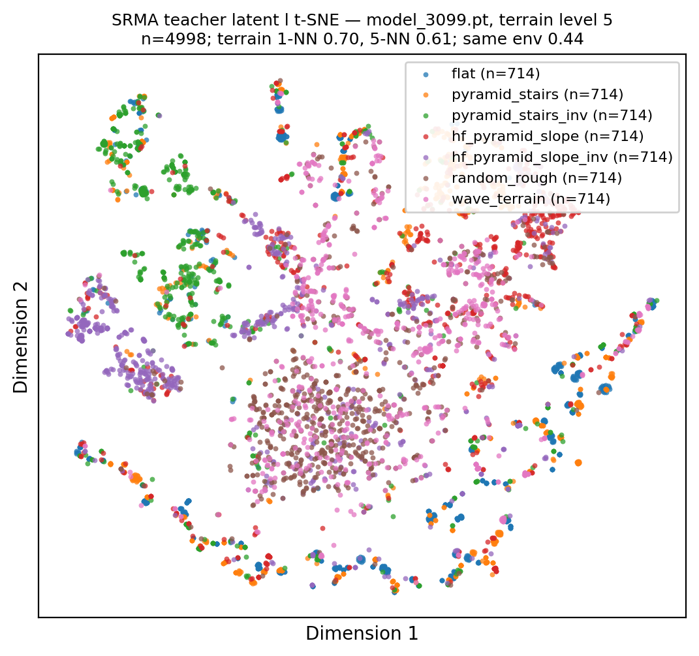
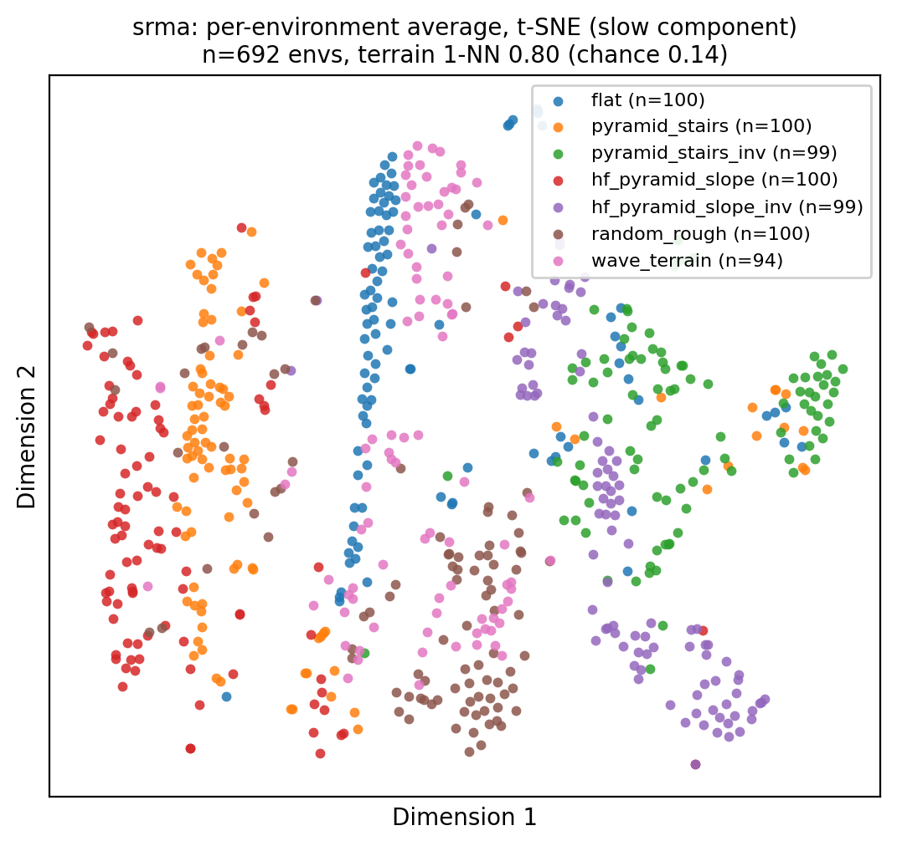
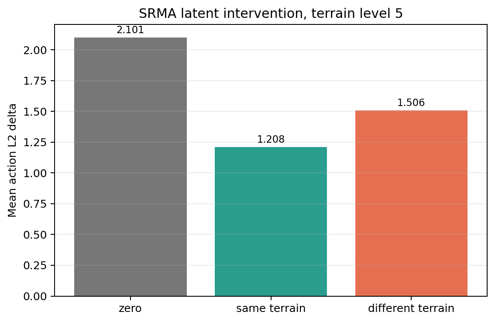

# SRMA Teacher 实验记录

## 0. 对象与训练结果

- checkpoint：
  `logs/rsl_rl/go1_srma_teacher/2026-10-18_15-14-45/model_3099.pt`
- 配置：4096 envs，50 Hz，external mode = full，16-D latent。
- 最终 iteration 3099：
  - mean reward ≈ 56.86；
  - mean episode length ≈ 882；
  - terrain level mean ≈ 5.65；
  - `error_vel_xy` ≈ 0.54；
  - illegal-contact termination ≈ 1.25；
  - latent effective rank ≈ 7.20；
  - action delta zero ≈ 1.96；
  - action delta shuffle ≈ 1.21。

## 1. 固定地形 latent t-SNE

### 协议

- 固定 terrain level 5；
- 700 envs，7 类地形均衡分配；
- 固定命令 `vx=1.0 m/s, vy=0, yaw_rate=0`；
- 关闭观测噪声和 push；
- warmup 60 steps，采样 800 steps，每 4 steps 取一次；
- 收集 120,162 个原始样本；
- 13/700 个环境在采样期间终止，永久剔除；
- t-SNE 使用每类 714 点，共 4,998 点，perplexity 30、1,000 iterations。

### 结果



| 指标 | 数值 | 随机基线 |
| --- | ---: | ---: |
| 2-D t-SNE，1-NN 同地形 | 0.700 | 0.143 |
| 2-D t-SNE，5-NN 同地形 | 0.607 | 0.143 |
| 16-D latent，1-NN 同地形 | 0.708 | 0.143 |
| 16-D latent，5-NN 同地形 | 0.613 | 0.143 |
| 2-D t-SNE，1-NN 同环境 | 0.437 | ≈0.0014 |
| PC1 / PC2 variance | 32.1% / 19.7% | — |
| PCA effective rank | 5.63 | — |

逐帧图上已经能看到多个按地形分离的局部结构，但“同一环境”的最近邻比例很高，
说明短时轨迹仍影响邻域结构。

## 2. 慢变成分与步态相位

### 结果

- FR calf 关节角 Hilbert 相位只解释 **3.0%** 的 teacher latent 方差；
- 原始逐帧 latent 的地形 1-NN：0.708；
- 去掉相位成分后的地形 1-NN：0.543；
- 每环境平均后的地形 1-NN：**0.803**；
- 每环境平均后剩 692 个环境点，随机基线 0.143。



慢变成分显示出清晰的地形结构。flat、stairs、slope 和 rough 的大部分环境形成
可分区域，但仍存在 rough/wave/slope 之间的混叠。

相位解释率很低，却会导致去掉相位后 1-NN 下降，说明相位及其耦合轨迹对局部邻域仍有
明显影响；因此逐帧 t-SNE 和每环境平均必须同时报告。

## 3. Latent 交换动作敏感性

### 协议

在相同状态、相同命令和同一 actor 下比较三种输入：

1. 正常 latent；
2. `latent=0`；
3. 换成不同地形环境在同一时刻的 latent。

700 envs，level 5，warmup 60，采样 500 steps。

### 结果

| 干预 | 平均动作 L2 变化 |
| --- | ---: |
| latent = 0 | 2.101 |
| 同地形另一环境 latent | 1.208 |
| 不同地形 latent | 1.506 |



- 不同地形 latent 比同地形 latent 多产生 **0.298** 的动作变化；
- 不同地形交换达到 zero-latent 效应的约 **72%**；
- 同地形交换仍有 1.208 的变化，说明 latent 还包含摩擦和不同 patch 的局部几何等
  非类别标签因素；
- 按地形拆分后，flat、stairs、上坡对“错误地形 latent”反应明显；rough、wave
  和部分反向地形的差异较弱，这些类别可能共享局部几何特征或与摩擦变化混淆。

## 4. 闭环 Latent 干预

### 协议

- 256 envs；
- 每格 1,000 steps，即 20 s；
- 固定命令 `vx=1.0 m/s`；
- level 3 / 5 / 7；
- 关闭训练噪声和 push；
- 分别运行正常 latent、zero latent、不同地形 latent。

### 结果

数值为每 256 envs / 20 s 的终止计数。

| Level | Latent | Reward / step | Falls | Error vel xy | Peak joint vel |
| --- | --- | ---: | ---: | ---: | ---: |
| 3 | normal | 0.0890 | 1 | 0.305 | 23.9 |
| 3 | zero | 0.0534 | 20 | 0.706 | 48.0 |
| 3 | wrong terrain | 0.0727 | 41 | 0.492 | 40.8 |
| 5 | normal | 0.0830 | 16 | 0.452 | 44.9 |
| 5 | zero | 0.0439 | 80 | 0.594 | 57.5 |
| 5 | wrong terrain | 0.0595 | 107 | 0.552 | 61.6 |
| 7 | normal | 0.0782 | 38 | 0.442 | 36.4 |
| 7 | zero | 0.0409 | 270 | 0.385 | 84.2 |
| 7 | wrong terrain | 0.0553 | 253 | 0.455 | 62.3 |

正常 latent 在所有等级上的 reward 和 survival 都最好。Level 5/7 中 zero 和
wrong-terrain latent 的终止数增加约 5–8 倍，确认 teacher 的闭环行为实际依赖外部
latent，而不只是表示层相关。

Level 7 的 zero-latent `error_vel_xy` 反而低于 normal，是因为失败策略可能通过停止或
摔倒减少了速度误差；该指标不能单独使用，必须与 reward、falls 和 episode survival
联读。

## 5. 结论

1. teacher latent 明确编码了地形信息：
   - level 5 每环境平均地形 1-NN = 0.803；
   - 相位只解释 3.0% 方差。
2. latent 不是纯粹的人类可读地形标签：
   - 同地形交换仍产生较大动作变化；
   - per-terrain 错误 latent 效应不均匀；
   - friction、局部 patch 和轨迹状态同样进入 latent。
3. 策略确实使用了外部 latent：
   - zero/wrong-terrain latent 在 level 5/7 显著降低 reward 和 survival；
   - normal latent 在 level 7 的终止数为 38，zero/wrong 为 270/253。

当前证据支持“teacher 学到了对控制有用的外部环境信息”。尚未完成的是
`none/map/map_friction/full` 的外部信息训练消融；该实验用于拆分地形、摩擦和外力各自
的贡献。

## 6. 文件

- `实验数据/tsne_latent.py`
- `实验数据/latent_decompose.py`
- `实验数据/phase_check.py`
- `实验数据/latent_intervention.py`
- `实验数据/closed_loop_eval.py`
- `实验数据/stairs_eval.py`
- `实验数据/tsne_srma_model_3099_L5.png/.npz`
- `实验数据/tsne_srma_model_3099_L5_envmean.png/.npz`
- `实验数据/latent_intervention_L5.png/.json`
- `实验数据/closed_loop_eval.json`
- `实验数据/stairs_eval.json`

## 7. 楼梯高度专项诊断

### 训练课程实际覆盖

Iteration 3099 的每类地形平均等级：

| 地形 | 平均 level | 约对应台阶高度 |
| --- | ---: | ---: |
| `pyramid_stairs` | 6.59 | 18.3 cm |
| `pyramid_stairs_inv` | 4.36 | 12.1 cm |
| 全部地形平均 | 5.65 | — |

因此虽然配置上限提高到 25 cm，最终策略主要在约 18 cm 的正向楼梯和约 12 cm 的
反向楼梯上训练。25 cm 对当前 checkpoint 属于课程外或课程边缘难度。

### 专项评测

126 envs，600 steps（12 s），固定 `vx=1.0 m/s`，分别把所有环境固定在单一楼梯类型。


| 类型 | 台阶高度 | 平均前进速度 | 12 s 位移 | 停止时间占比 | Falls |
| --- | ---: | ---: | ---: | ---: | ---: |
| stairs | 8.3 cm | 0.784 | 9.41 m | 11.3% | 0.00 |
| stairs | 13.9 cm | 0.708 | 8.50 m | 15.3% | 0.00 |
| stairs | 19.4 cm | 0.584 | 6.48 m | 28.0% | 0.21 |
| stairs | 25.0 cm | 0.487 | 4.80 m | 39.8% | 0.32 |
| inverted | 8.3 cm | 0.779 | 9.35 m | 11.5% | 0.01 |
| inverted | 13.9 cm | 0.529 | 6.34 m | 31.1% | 0.01 |
| inverted | 19.4 cm | 0.168 | 1.87 m | **74.3%** | 0.08 |
| inverted | 25.0 cm | 0.136 | 1.53 m | **81.7%** | 0.11 |

停止定义为前进速度低于 0.1 m/s，`Falls` 为每环境在该评测时长内的终止次数。

### 现象与原因

1. 高台阶没有充分训练：反向楼梯最终平均只到 level 4.36。
2. 当前步态抬脚过低：训练末期 `Metrics/peak_height_mean=0.037 m`，而 clearance
   target 为 0.10 m。该步态不足以越过 20–25 cm 的 riser。
3. 固定 target 的 absolute clearance penalty 会同时惩罚抬得过高和过低，并由脚速
   加权。策略在无法安全抬到目标高度时会通过降低脚速甚至停住来减小惩罚。
4. 当前 teacher 高度图只覆盖机身下方约 `0.5 x 0.4 m`，没有前向 lookahead。接触前
   可获取的台阶边缘信息有限，下降场景更依赖事后恢复。

### 奖励修改

已将 `feet_clearance` 和 `feet_swing_height` 都改为单边惩罚：

```text
shortfall = max(target_height - foot_height, 0)
```

脚高于目标时不再产生 cost，因此高台阶所需的额外抬脚不会被原来的 absolute
clearance penalty 抵消。

随后将自适应高度只加入 `feet_swing_height`：

```text
roughness = p90(height_scan) - p10(height_scan)
rho = clip((roughness - 0.02) / (0.20 - 0.02), 0, 1)
target_height = 0.10 + 0.15 * rho
```

- 使用原 `terrain_scan` 的 1.6 x 1.0 m 范围；
- 只使用有效 ray；
- 不做时间平滑；
- `foot_clearance` 继续保持固定 10 cm 单边下限；
- `action_rate_l2` 本轮不变。

### 单边奖励复测

单边奖励 fine-tune 后，训练末期 `peak_height_mean` 从约 3.7 cm 提高到约 4.1 cm。
1 m/s 固定命令下：

| 类型 | 高度 | 旧停止占比 | 单边停止占比 | 单边位移 |
| --- | ---: | ---: | ---: | ---: |
| stairs | 19.4 cm | 28.0% | 19.4% | 7.75 m / 12 s |
| stairs | 25.0 cm | 39.8% | 22.8% | 6.65 m / 12 s |
| inverted | 19.4 cm | 74.3% | 72.4% | 1.91 m / 12 s |
| inverted | 25.0 cm | 81.7% | 79.8% | 1.70 m / 12 s |

正向楼梯停止比例下降，但 25 cm 的失败次数增加；反向楼梯在标准测试地形上仍大量停止。
用户实机/播放场景中下降行为改善，说明单边惩罚有效，但高度和场景仍可能不同。

将命令降到 0.5 m/s 后，正向 19.4/25 cm 楼梯停止比例反而达到 59.6%/63.0%，
位移只有约 1.8 m，说明当前问题不是“接近速度太快”，降低命令不能解决高台阶。

### 后续优先实验

1. 将 `foot_clearance` 和 `foot_swing_height` 暂时置零，验证停止行为是否消失。
2. 把 fixed absolute clearance penalty 改成 one-sided penalty：
   `max(target_height - foot_height, 0)`，只惩罚抬脚不足，不惩罚高抬脚。
3. target 根据局部地形高度增加，例如基础 6–8 cm 加预测 riser 高度。
4. 增加反向楼梯过采样，或单独训练 level 6–9，避免 25 cm 只出现在课程上限。
5. 如果奖励修复后仍无法下降，再扩大 teacher 高度图的前向覆盖范围。

### swing height 自适应复测与回退

在 play 中观察到，策略静止或没有新的落足事件时，`feet_swing_height` 的 cost
接近 0，`foot_clearance` 也会因为脚速接近 0 而接近 0。高台阶前尝试抬脚时，
前者可能因为自适应目标升高而承担更重的落地惩罚，后者仍会惩罚不足 10 cm 的
摆腿高度；主动接近高台阶还会增加 action-rate、slip 和碰撞风险。因此“不动”
成为局部的低风险解。

该项改动未改善上台阶行为，已回退：

- 删除 `terrain_scan` 的 roughness 估计、自适应目标和对应日志；
- `feet_swing_height` 恢复固定 10 cm 的单边目标：
  `max(0.10 - peak_height, 0)^2 / 0.10^2`；
- 保留 `foot_clearance` 的固定 10 cm 单边下限；
- `action_rate_l2` 本轮不变。

宽范围 scan 的 `p90 - p10` 描述的是环境整体起伏，不等于摆动脚前方或落足点高度，
不能让目标只在高 riser 附近升高，因此不适合作为该奖励的自适应变量。

### 静止局部最优

当前速度指令为 1 m/s 且机器人静止时，线速度跟踪项仍约为
`2 * exp(-1 / 0.25) = 0.036`。角度跟踪、upright 和 pose 又基本照常获得奖励，
所以静止不是“零收益”；而攀爬高台阶会承担额外 cost。

将指令降到 0.5 m/s 后，静止时的线速度跟踪项反而约为
`2 * exp(-(0.5 / 0.5)^2) = 0.736`，尝试移动的相对收益更小。这与低指令下
停止占比升高的现象一致，说明降低速度不能解决该问题。

下一轮按单项对照进行，不同时修改多个奖励：

1. 暂时将 `foot_clearance` 和 `feet_swing_height` 权重置零，从当前教师
   checkpoint 短程 fine-tune，确认清除 cost 后是否恢复移动。
2. 若移动恢复，将 clearance 改为首次落地时的正向奖励，例如
   `clip(peak_height / 0.10, 0, 1)`，不再使用负惩罚。
3. 增加与指令方向一致的短尺度 progress 或 idle cost，使非零指令下静止严格劣于
   向前尝试。progress 在很小的速度即可饱和，避免继续依赖
   `exp(-error/std^2)` 在接近静止时很弱的梯度。
4. 仅在日志确认 action-rate cost 确实占主导后，再降低其权重或使用地形条件缩放；
   不把 action-rate 与其他改动混在同一次实验。
5. 奖励修复后仍无法通过 19–25 cm 台阶，再单独增加高台阶/反向楼梯采样。
