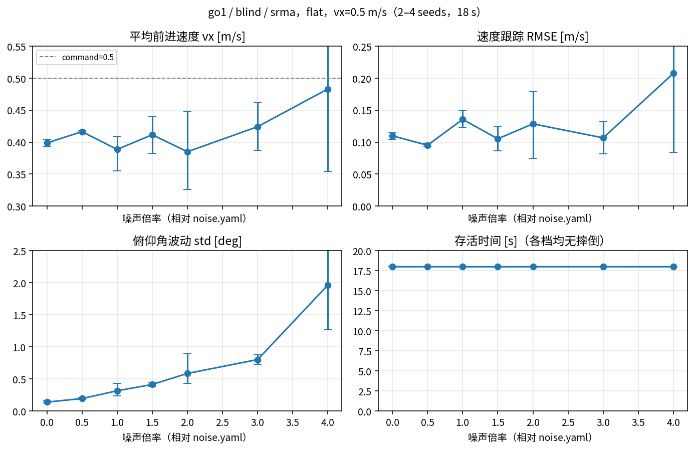
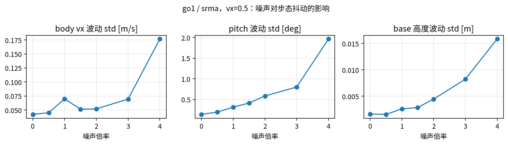
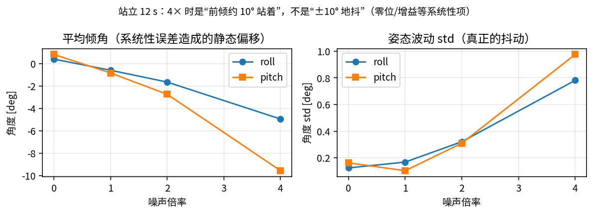
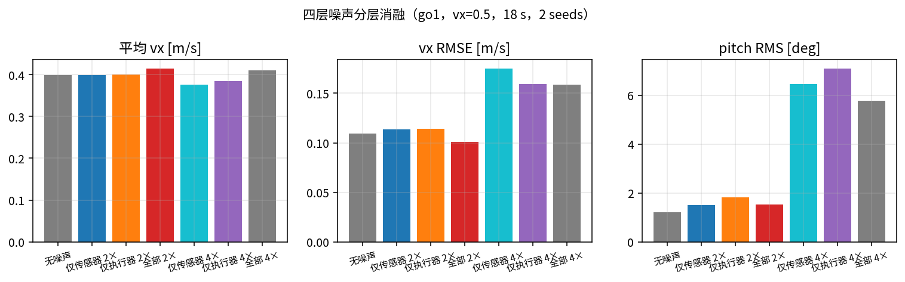
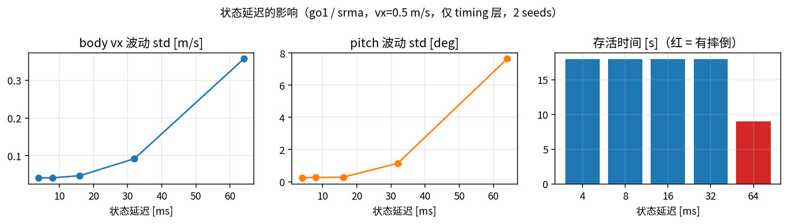
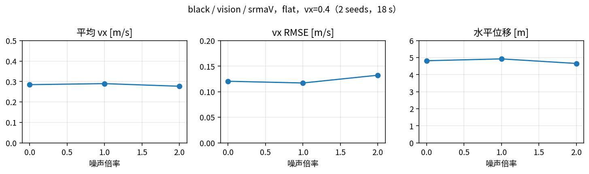
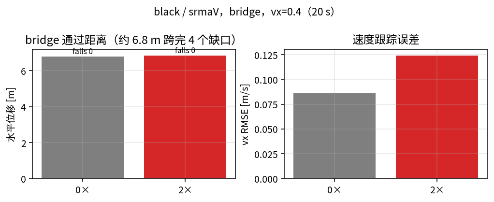
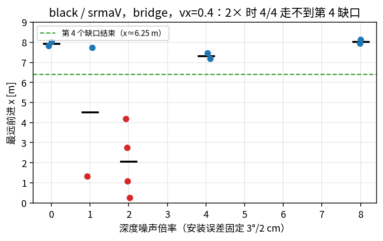
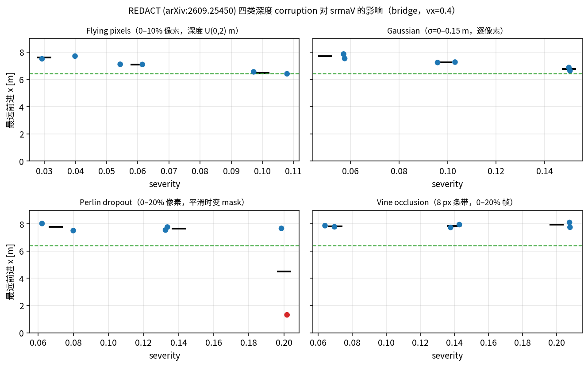
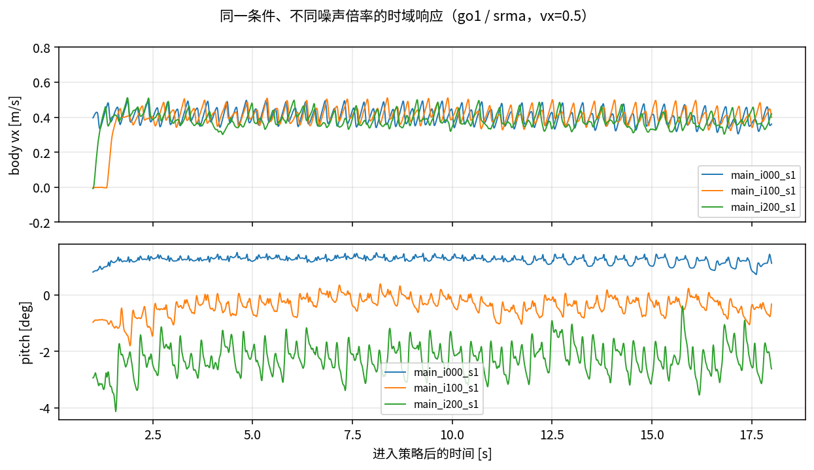

# 视觉学生抗噪灵敏性分析

**日期** 2026-11-01 · **仿真** MuJoCo 3.3.5（`--headless`） · **策略** `go1/blind/srma`、`black/vision/srmaM`
**数据** `test/results/`（106 个 episode：55 主实验 + 51 深度扩展（安装误差 18 + 大块无效 4 + REDACT 26 + 全失效 3），JSON + CSV + 图） · **噪声配置** `mujoco/simulate/noise.yaml`

---

> 来源：`deploy/test/灵敏性分析.md` 的同步版本（2026-11-02）。
> 实验脚本与原始数据在 `deploy/test/`；本文命令中的 `./test/...` 均在 `deploy/` 下执行。
> 图在本目录 `figs/`。


## 摘要

- 给仿真加了四层非理想模型：**传感器 / 执行器 / 时序 / 深度**，默认关闭，`noise=real` 显式开启；零位/量化按 mjlab `encoder_bias` 语义同时进入 PD 和上报。
- **盲走策略（go1 / srma）在 flat 上对观测噪声很鲁棒**：0–4× 主扫描 22 个 episode 无一摔倒；0–3× 的速度跟踪基本不变，4× 才明显退化（RMSE 0.110 → 0.207 m/s）。
- **步态波动（pitch std）是最灵敏的指标**：trot 时从 0.14° 单调涨到 1.96°（4×，约 14 倍）；站立时主要不是抖动，而是**平均倾角**从 0.4°/0.8° 变到 -5.0°/-9.6°（零位/增益等系统性误差），残余 std 只有 0.8°/1.0°。
- **状态延迟是唯一能单独把策略打崩的项**：≤16 ms 无影响；32 ms 开始过速（mean_vx 0.69，vx 波动翻倍）；64 ms 两个 seed 都摔倒（存活 3.6 s / 14.2 s）。
- **深度噪声（black / srmaM）影响很小**：flat 上仅深度层 2× 时 RMSE 0.120 → 0.147；bridge 上 0.086 → 0.091，仍跨完 4 个缺口（x > 6.25 m）；没有摔倒。
- **但相机安装误差是另一回事**：固定 3°/2cm 安装误差后，深度噪声 2× 时 4/4 都走不到第 4 个缺口；0×、4×、8× 反而 2/2 都能跨完。失效对噪声不是单调的，安装误差本身已接近这条视觉策略的边界。
- 结论：**训练分布内的观测噪声不是这套策略的瓶颈；真正需要按实机标定的是延迟、执行器动态和零位这些训练没覆盖/没充分覆盖的系统项。** 白噪声按 1× 开即可，不必追高。

---

## 1. 目标与范围

目标是给仿真部署加一层可配置的“实机噪声”，用于回答两个问题：

1. 加多少噪声会开始影响策略（灵敏度曲线、阈值）；
2. 哪些噪声是主要矛盾，实机标定时应该先测哪些量。

范围：只改仿真侧（`rl_sar_sim`），不改控制器和策略；噪声默认关闭，显式 `noise=none|real|<path>` 才生效；一个 YAML 管四层。

测试对象选两条已验证的组合：

- `go1 / blind / srma`（ONNX，45 维观测，平地主测）；
- `black / vision / srmaM`（ONNX + 160×90 深度，测深度噪声和 bridge）。

`himloco` / `robot_lab` / `mimic` 不在本轮，原因见 §6。

---

## 2. 噪声模型

### 2.1 四层与注入点

| 层 | 内容 | 注入点 |
|---|---|---|
| **sensors** | gyro/accel 白噪声 + 常值偏置 + 随机游走 + 刻度误差 + 饱和；quat 角度白噪声 + yaw 漂移；关节零位/量化/白噪声；dq 差分滤波；tau_est/ddq | `fillState()`；**零位/量化同时进 `applyCommand()` 的 PD** |
| **actuators** | kp/kd 增益误差、力矩一阶滞后、指令延迟/量化、摩擦/阻尼倍率 | `applyCommand()` |
| **timing** | 状态延迟、发布抖动、整包丢帧 | `run_loop()` |
| **depth** | σ(z)=σ₀+k·z²、随机空洞、边缘飞点、1 mm 量化、1 帧延迟、整帧丢包、相机安装误差 | `renderDepth()` / `depth_loop()` |

两个设计要点：

- **零位不是“只改上报”**。按 mjlab 的 `encoder_bias` 语义，`q_meas = q_true + b`，电机驱动器的 PD 和上报共用 `q_meas`。这样零位会把实际姿态压偏，而稳态观测里看不出来——如果只加到上报，策略会把偏置闭环补偿掉，等于没加。
- **q 的白噪声只进上报，dq 的噪声会进阻尼项**。驱动器内环用编码器值（含零位/量化）做 PD；q 的遥测白噪声只加在发布副本上，而 dq 的噪声经过 80 Hz 低通后也进入 kd 项——实机驱动器同样用带噪声的速度估计做阻尼。

实现：`noise.h`、`noise.cpp`、`ros2_bridge.h`。

### 2.2 量级与训练参考

`noise.yaml` 的 1× 取值刻意贴近“训练时见过的量级”，而不是凭空拍一个很大的数。下表是 `../mjlab` 里同名 `srma` 任务的 actor 观测噪声（uniform，换算成 1σ）与本 YAML 的对照：

| 项 | 训练参考（mjlab srma） | 本 YAML 1× | 4×（≈ 训练上限） |
|---|---|---|---|
| gyro 白噪声 | U(±0.2) → σ≈0.115 rad/s | 0.05 | 0.20 |
| joint q 白噪声 | U(±0.01) → σ≈0.0058 rad | 0.003 | 0.012 |
| joint dq 白噪声 | U(±1.5) → σ≈0.87 rad/s | 0.2（LPF 80 Hz 后实测 0.135） | 0.8（实测 0.54） |
| gravity / quat 角度 | 分量 U(±0.05) → ≈1.7° | 0.5° | 2.0° |
| 关节零位 | U(±0.015) → σ≈0.0087 rad | 0.008 | 0.032 |
| kp/kd 增益误差 | 训练未随机化 | 10% | 40% |
| 状态延迟 | 训练未随机化 | 2 ms | 8 ms |
| 深度噪声 | 训练为合成深度 | σ₀=3 mm, k=0.002 | 4× |

也就是说：**1× 比训练噪声小，2× 接近训练，4× 大体在训练分布边缘**。这解释了后面“4× 才开始明显退化、但仍不摔”的现象。

### 2.3 噪声是否真的加上了

用 `RL_SAR_NOISE_STATS=1` 直接测发布通道的 std（headless，go1 站立，1 s 窗口）：

| intensity | gyro std [rad/s] | q std [rad] | dq std [rad/s] |
|---|---|---|---|
| 1× | 0.0505 / 0.0517 / 0.0481 | 0.00309 | 0.1354 |
| 2× | 0.1015 / 0.1053 / 0.0965 | 0.00610 | 0.2716 |
| 4× | 0.2105 / 0.2107 / 0.1925 | 0.01243 | 0.5435 |

与配置值一致（gyro 0.05/0.10/0.20；q 0.003/0.006/0.012；dq 因 80 Hz 低通从 0.2 衰减到 0.135）。q 的 0.00309 略高于 0.003，包含约 0.0004 rad 的 12 bit 量化台阶（1.53e-3 rad/LSB）。

---

## 3. 测试方法

### 3.1 自动化 episode

每个 episode 都是完整的 `rl_sar_sim` + `rl_sar_deploy`：

1. `--headless` 启动仿真（无窗口；深度仍用 `mj_ray` 渲染）；
2. 控制器跑在 pty 上，脚本写按键：`0` 起身 → 等 4 s → `1` 进策略（失败重试）→ `n` 开导航；
3. 通过 `/cmd_vel` 以 20 Hz 发速度指令（不走键盘，保证可复现）；
4. 跑 18–20 s，`9` 趴下，收尾；
5. 用仿真 100 Hz 的 `[qpos]` 日志（去重后 200 Hz）算指标。

入口：`test/run_sensitivity.sh`、`test/run_episode.py`、`test/lib/harness.py`。

### 3.2 矩阵

| 组 | 对象 | 变量 | episode 数 |
|---|---|---|---|
| main | go1 / srma / flat / vx=0.5 | 0, 0.5, 1, 1.5, 2, 3, 4×；0/1/2/4× 4 seeds，其余 2 seeds | 22 |
| stand | 同上 / vx=0 | 0, 1, 2, 4× | 4 |
| layers | 同上 | 2×/4× 仅 sensors、仅 actuators | 8 |
| timing | 同上 | 仅 timing，状态延迟 4/8/16/32/64 ms | 10 |
| depth | black / srmaM / vx=0.4 | flat 0/1/2×、bridge 0/2× | 8 |
| depthonly | 同上 | 仅 depth 层 2×，flat 2 seeds + bridge 1 | 3 |
| depthmount | 同上 / bridge | 固定 3°/2cm 安装误差，深度噪声 0/1/2/4/8×；2× 加 2 seeds | 12 |
| depthmountx2 | 同上 / bridge | 固定 6°/4cm 安装误差，深度噪声 0/2/8× | 6 |
| depthblob | 同上 / bridge | 6°/4cm + 3 个大块静态无效区域，深度噪声 0/8× | 4 |
| redact | 同上 / bridge | REDACT 四类 corruption × 3 档 × 2 seeds + clean 2 | 26 |
| depthblind | 同上 / bridge + flat | 深度整幅置 0（mask 全 0） | 3 |
| **合计** | | | **106** |

“倍率”是把 `noise.yaml` 里所有随机项和系统性项（白噪声、偏置、增益误差、延迟、安装误差、深度噪声）乘同一个系数；量化步长和滤波截止频率不缩放。每个 episode 的实际 YAML 在 `results/configs/`。

### 3.3 指标

窗口从进策略后 1 s 开始，取 18 s（bridge 20 s）：

- `survival_time` / `fall_time`：base 高度 < 0.15 m，或 |roll|/|pitch| > 60°；
- `mean_vx` / `rmse_vx`：世界速度转到 body frame 的 x 分量，对比 `/cmd_vel`；
- `vx_std`、`pitch_std`、`z_std`：窗口内波动，衡量步态抖动（比 RMS 更不受平均姿态偏移影响）；
- `distance_xy`：水平位移（bridge 用来判断是否跨完缺口）。

### 3.4 统计口径

- 0/1/2/4× 各 4 个 seed，0.5/1.5/3× 各 2 个；图中误差棒是 min–max。
- 由于 ROS/按键时序不完全可控，重复运行之间本身就有几个百分点的差异；**小于约 5% 的差别不应解读为噪声效应**。
- 无噪声的 0× 是“4 次重复”，不是 4 个随机种子；它的离散度就是 run-to-run 方差。

---

## 4. 结果

### 4.1 主扫描：0–4× 不摔，4× 开始明显退化



| 噪声倍率 | runs | falls | 存活 [s] | vx 均值 | vx RMSE | vx std | pitch std [°] | z std [mm] |
|---|---|---|---|---|---|---|---|---|
| 0× | 4 | 0 | 18.0 | 0.399 | 0.110 | 0.042 | 0.14 | 1.6 |
| 0.5× | 2 | 0 | 18.0 | 0.416 | 0.095 | 0.045 | 0.19 | 1.5 |
| 1× | 4 | 0 | 18.0 | 0.389 | 0.135 | 0.070 | 0.31 | 2.6 |
| 1.5× | 2 | 0 | 18.0 | 0.411 | 0.105 | 0.051 | 0.41 | 2.8 |
| 2× | 4 | 0 | 18.0 | 0.385 | 0.128 | 0.052 | 0.58 | 4.4 |
| 3× | 2 | 0 | 18.0 | 0.424 | 0.107 | 0.069 | 0.80 | 8.2 |
| 4× | 4 | 0 | 18.0 | 0.483 | 0.207 | 0.177 | 1.96 | 15.9 |

读法：

- **速度**：0–3× 的 `mean_vx`/`RMSE` 都落在 run-to-run 方差内（0.38–0.42 m/s，RMSE 0.10–0.14）；4× 时 RMSE 翻到 0.207，`vx_std` 从 ~0.05 涨到 0.177，开始“忽快忽慢”。
- **姿态**：`pitch_std` 是单调的，0.14° → 0.31° → 0.58° → 1.96°，4× 时是基线的 14 倍。这个指标比 `mean_vx` 灵敏得多。
- **存活**：22 个 episode 没有一次摔倒；4× 只表现为“走得难看”，还没有到失稳。



`z_std`（base 高度波动）同样单调：1.6 mm → 15.9 mm，4× 时约 9.9 倍。这和“腿更抖、踏步更重”的直觉一致。

### 4.2 站立：主要看到的是静态倾角，不是抖动

站立（vx=0）没有步态相位和指令跟踪的干扰，最容易看出**静态姿态偏移**；但要区分“平均倾角”和“抖动”：



| 噪声倍率 | 平均 roll [°] | 平均 pitch [°] | std roll [°] | std pitch [°] |
|---|---|---|---|---|
| 0× | 0.40 | 0.82 | 0.12 | 0.16 |
| 1× | -0.59 | -0.83 | 0.17 | 0.10 |
| 2× | -1.65 | -2.74 | 0.32 | 0.31 |
| 4× | -4.95 | -9.56 | 0.78 | 0.98 |

这里要先澄清一个容易误读的点：**站立 12 s 的 RMS 主要由平均倾角贡献，不是抖动**。0× 的平均 roll/pitch 是 0.40°/0.82°、std 0.12°/0.16°；4× 的平均是 -4.95°/-9.56°，而 std 只有 0.78°/0.98°。也就是说 4× 时机器人是“前倾约 10° 站着”，不是“±10° 地抖”。

这部分来自零位/增益这类**系统性误差**：策略在稳态观测里看不到零位（见 §2.1 的 `q_meas = q_true + b`），所以无法把姿态拉回竖直。它说明的是“系统性误差会改变姿态”，不是“IMU 抖动大”。

### 4.3 分层消融：传感器和执行器都贡献，2× 时都还不显著



| 配置 | vx 均值 | vx RMSE | pitch RMS [°] | 存活 [s] |
|---|---|---|---|---|
| 无噪声 | 0.399 | 0.109 | 1.21 | 18.0 |
| 仅 sensors 2× | 0.399 | 0.114 | 1.51 | 18.0 |
| 仅 actuators 2× | 0.401 | 0.114 | 1.81 | 18.0 |
| 全部 2× | 0.415 | 0.101 | 1.53 | 18.0 |
| 仅 sensors 4× | 0.375 | 0.175 | 6.45 | 18.0 |
| 仅 actuators 4× | 0.384 | 0.159 | 7.09 | 18.0 |
| 全部 4× | 0.410 | 0.159 | 5.77 | 18.0 |

> 分层消融统一只用 seed 1–2（每组 2 次），所以“全部 2×/4×”的数和主表（0/1/2/4× 有 4 个 seed）略有不同。全部 4× 的两个 seed 分别是 pitch 7.9° 和 3.6°，均值 5.8° 低于单层是 seed 方差，不是“叠加反而更好”。

- 2× 时三档的 RMSE 都是 0.10–0.11、pitch 1.5–1.8°，彼此差异在方差内；**没有哪一层单独主导**。
- 4× 时 sensors-only 和 actuators-only 的 pitch RMS 都到 6–7°，说明两条路径都能把步态搞抖；执行器（10%→40% 增益误差）略强，但差距不足以说“执行器才是主因”。
- 4× 全部叠加的 RMSE 0.159 与 4× 单层（0.16–0.18）同一量级，没有出现“1+1 突然崩”的强非线性。

### 4.4 状态延迟：唯一的悬崖



| 延迟 [ms] | vx 均值 | vx std | pitch std [°] | 存活 [s] |
|---|---|---|---|---|
| 4 | 0.424 | 0.041 | 0.24 | 18.0 |
| 8 | 0.438 | 0.041 | 0.27 | 18.0 |
| 16 | 0.471 | 0.047 | 0.28 | 18.0 |
| 32 | 0.686 | 0.092 | 1.15 | 18.0 / 18.0 |
| 64 | 0.858 | 0.357 | 7.64 | **3.6 / 14.2** |

- 4–16 ms 基本没有区别：`vx_std` 0.041–0.047，`pitch_std` 0.24–0.28°；16 ms 的平均速度从 0.42 漂到 0.47，可以看作 32 ms 过速的前兆。
- 32 ms（约 1.6 个 RL 步）开始“过速”：`mean_vx` 到 0.69 m/s（指令 0.5），`vx_std` 翻倍到 0.092，`pitch_std` 到 1.15°。
- 64 ms（约 3 个 RL 步）两个 seed 都摔：一个 3.6 s 就倒，另一个撑到 14.2 s；倒下前平均速度 0.86 m/s，`vx_std` 0.357。

这是全部实验里**唯一一个单因素就能让策略摔倒的项**，也是和 sim2real 最相关的发现：训练时没有随机化延迟，控制回路对相位滞后没有裕度。

### 4.5 深度噪声：影响小，bridge 仍能跨完 4 个缺口





| 场景 | 噪声 | vx 均值 | vx RMSE | 存活 [s] | falls |
|---|---|---|---|---|---|
| flat | 0× | 0.285 | 0.120 | 18.0 | 0 |
| flat | 1× | 0.290 | 0.117 | 18.0 | 0 |
| flat | 2×（全部层） | 0.277 | 0.132 | 18.0 | 0 |
| flat | 2×（仅 depth） | 0.260 | 0.147 | 18.0 | 0 |
| bridge | 0× | 0.359 | 0.086 | 20.0 | 0 |
| bridge | 2×（全部层） | 0.361 | 0.124 | 20.0 | 0 |
| bridge | 2×（仅 depth） | 0.348 | 0.091 | 20.0 | 0 |

- flat 上仅深度噪声 2× 让 RMSE 从 0.120 到 0.147（+22%），但没有改变行为；说明视觉输入在这条平地上不是关键。
- bridge 上 0× 和 2× 都走完 4 个缺口：第四块桥面边缘在世界 x≈6.25 m，0× 的 `xmax=6.64 m`，全部层 2× 的 `xmax=7.55 m`，仅 depth 2× 的 `xmax=6.68 m`，都在最后一块桥面上，没有掉坑。
- bridge 上“全部层 2×”的 RMSE 升高（0.086→0.124）主要来自本体噪声；仅 depth 2× 只升到 0.091。**深度噪声本身在 D435 量级下不是瓶颈**，至少在平地和这座 4 缺口桥上是这样。

#### 4.5.1 固定安装误差（3°/2cm）后的深度噪声倍率

上面的深度噪声是“相机安装与训练完全一致”时测的。把安装误差固定为 **3°/2cm**（`mount_rpy_deg=[1,3,1]°`、`mount_xyz=[0.02,0,0.01] m`），只开 depth 层，在 bridge 上做 0/1/2/4/8× 扫描（2 seeds；2× 额外补 2 seeds）。

这里的倍率**只缩放随机深度噪声**：轴向 σ(z)、随机空洞率、飞点率；安装误差（3°/2cm）、1 mm 量化、1 帧延迟、整帧丢包都固定不变。具体到 2 m 处：2× 时 σ≈22 mm、空洞 2%、飞点 2%；8× 时 σ≈88 mm、空洞 8%、飞点 8%。所以“8× 恢复”不是安装误差变大，而是深度随机噪声更大。



| 倍率 | runs | 跨完 4 缺口 | 平均 max_x [m] | 备注 |
|---|---|---|---|---|
| 0× | 2 | 2/2 | 7.92 | 跨完但末段摔（x≈7.3 m，已在第 4 缺口之后） |
| 1× | 2 | 1/2 | 4.52 | s2 在 x≈1.1 m 早摔 |
| 2× | 4 | 0/4 | 2.06 | 4 个 seed 全部走不到第 4 缺口 |
| 4× | 2 | 2/2 | 7.31 | 反而恢复 |
| 8× | 2 | 2/2 | 8.03 | 恢复 |

结论：

- **没有单调的“N 倍就挂”阈值**。2× 是最可复现的失败点（4/4），但 4×/8× 又都能跨完。一个可能的解释是：2× 的深度“轻度变差但仍被信任”，相机偏移让缺口位置估计偏掉；4×/8× 的空洞/飞点多到 mask 大面积失效，策略反而退回干净的本体感觉，所以能走。这个解释本轮没有单独验证。
- **安装误差是主因，不是深度白噪声**。同样的 depth-only 噪声，安装误差 0 时 2× 仍能过；2°/1cm 的非正式对照 0–4× 也都能过；而约 4°/4cm 时 0× 就在 7.5 s 摔倒（单次，未纳入正式矩阵）。3°/2cm 已经在边界上。
- 0× 的“末段摔”发生在跨完第 4 个缺口之后（x≈7.3 m，桥面到 8.0 m），所以按“是否跨完 4 个缺口”算通过；这也说明 3°/2cm 的余量已经很小。

**把安装误差翻倍到 6°/4cm** 后，结果又是另一种形态：

| 安装误差 | 倍率 | runs | 跨完 4 缺口 | 平均 max_x [m] |
|---|---|---|---|---|
| 3°/2cm | 2× | 4 | 0/4 | 2.06 |
| 6°/4cm | 0× | 2 | 2/2 | 7.67 |
| 6°/4cm | 2× | 2 | 1/2 | 6.93 |
| 6°/4cm | 8× | 2 | 2/2 | 7.50 |

- **6°/4cm + 8× 并没有更差**：两个 seed 都跨完（7.17/7.82），一个在跨完后 19.5 s 摔倒，一个没摔。
- **6°/4cm + 2× 也恢复到 1/2**（7.46/6.39；6.39 正好停在缺口边缘），而 3°/2cm + 2× 是 0/4。
- 所以 3°/2cm + 2× 的 4/4 是一个很窄的“失败口袋”，安装误差、深度噪声和失败之间**不是单调关系**；不能从“安装误差更大”推出“更容易摔”，也不能从“噪声更大”推出“更差”。这套视觉策略在深度输入退化时会表现出“坏得刚好最误导、坏得太多反而退回本体感觉”的非线性。

**8× + 6°/4cm 的预览命令**（按 headless 结果大概率能跨完，可能不会摔）：

```bash
RL_SAR_DEPTH_PREVIEW=1 ./scripts/start_all.sh \
    robot=black scene=bridge mode=vision vision=srmaM \
    noise=test/results/configs/depth_mount2x_high.yaml
```

对照（同 6°/4cm 安装误差，0× 噪声）：

```bash
RL_SAR_DEPTH_PREVIEW=1 ./scripts/start_all.sh \
    robot=black scene=bridge mode=vision vision=srmaM \
    noise=test/results/configs/depth_mount2x_baseline.yaml
```

想看“不行”的画面，仍建议用前面的 `depth_mount_fail.yaml`（3°/2cm + 2×，4/4 失败）。

**亲眼看的命令**（失败点，2× + 3°/2cm）：

```bash
RL_SAR_DEPTH_PREVIEW=1 ./scripts/start_all.sh \
    robot=black scene=bridge mode=vision vision=srmaM \
    noise=test/results/configs/depth_mount_fail.yaml
```

启动后按 `0` 起身，等 3–4 s，按 `1` 进策略，按 `n` 开导航；再开一个终端发速度：

```bash
source /opt/ros/humble/setup.bash
ros2 topic pub -r 20 /cmd_vel geometry_msgs/msg/Twist "{linear: {x: 0.4}}"
```

深度预览窗口标题是 `Depth input (Esc/q: close)`：**近处亮、远处暗、黑色=无效像素**，左上角显示 `valid xx% depth min-max`。2× 的失败配置里，你能同时看到安装误差造成的整体偏移和 2% 空洞/飞点；机器人会在 x≈0.3–1 m 附近走偏/倒退或摔倒。

对照命令（同安装误差，0× 噪声；以及 8× 噪声反而能走）：

```bash
RL_SAR_DEPTH_PREVIEW=1 ./scripts/start_all.sh \
    robot=black scene=bridge mode=vision vision=srmaM \
    noise=test/results/configs/depth_mount_baseline.yaml

RL_SAR_DEPTH_PREVIEW=1 ./scripts/start_all.sh \
    robot=black scene=bridge mode=vision vision=srmaM \
    noise=test/results/configs/depth_mount_high.yaml
```

注意：预览显示的是**策略实际吃到的**归一化深度（160×90×2 里的深度通道 + mask），不是原始 32FC1；`valid` 百分比和黑洞就是噪声/无效像素的直接反映。

#### 4.5.2 大块静态无效区域（3 个椭圆）

在 6°/4cm 安装误差上，再加 **3 个静态椭圆无效区域**（短轴 18 px、长宽比 2.2，位置/角度每个 run 采样一次后固定），只开 depth 层：

| 配置 | runs | 跨完 4 缺口 | max_x | 平均 vx |
|---|---|---|---|---|
| 6°/4cm + blobs，0× 噪声 | 2 | 0/2 | 0.99 / 1.01 | 0.02 / 0.04 |
| 6°/4cm + blobs，8× 噪声 | 2 | 0/2 | 1.04 / 0.99 | 0.03 / 0.05 |

4 个 run 都只走了约 1 m 就停住/原地打转（没有摔），**大块无效区域比 pixel 级噪声致命得多**：mask 把大片地面标成无效，策略没有足够的地形证据，干脆不走。0× 和 8× 都一样，说明主导因素是“无效面积”，不是噪声倍率。

预览命令：

```bash
RL_SAR_DEPTH_PREVIEW=1 ./scripts/start_all.sh \
    robot=black scene=bridge mode=vision vision=srmaM \
    noise=test/results/configs/depth_mount2x_high_blobs.yaml
```

#### 4.5.3 REDACT 论文的四类深度 corruption

arXiv:2609.25450（REDACT）在 Table I 里定义了五类评估条件，前四类是深度图 corruption，第五类是几何 distractor：

| 条件 | 论文定义（Table I） | 我们的实现 |
|---|---|---|
| Flying pixels | 0–10% 像素，深度替换为 U(0, 2) m | `corruption.type: flying`，`severity × 10%` |
| Gaussian | 每个像素加独立 N(0, σ²)，σ=0–0.15 m | `gaussian`，`severity × 0.15 m` |
| Perlin dropout | 0–20% 像素，用**时变 Perlin mask** 丢弃 | `perlin`，3D Perlin 梯度噪声（时间维），在 valid 像素上取 20% 分位 |
| Vine occlusion | 8 px 条带，随机位置/朝向，深度 U(0.05, 0.20) m，0–20% 帧 | `vine`，8 px 条带，`severity × 20%` 帧；深度取 0.30–0.50 m（我们 `depth_min=0.3`，0.05–0.20 会被判无效） |
| Pillar hurdle | 每个 hurdle 旁两根柱子，高度为 hurdle 的 3 倍；hurdle 0.10–0.40 m | **未实现**（属于地形/几何 distractor，不是深度图像噪声） |

论文另外在真实场景里提到 partial tree occlusion、depth dropout、低照度；related work 提到 Gaussian blur——这些不在 Table I 的受控扫描里，本轮也没测。

测试条件：只开 depth 层、安装误差 0、bridge、vx=0.4、20 s，每档 2 seeds。结果：



| 类型 | severity（物理量） | 跨完 4 缺口 | 平均 max_x |
|---|---|---|---|
| Flying pixels | 3% / 6% / 10% | 2/2、2/2、2/2 | 7.62 / 7.11 / 6.49 |
| Gaussian | 5 / 10 / 15 cm | 2/2、2/2、2/2 | 7.71 / 7.26 / 6.76 |
| Perlin dropout | 7% / 14% / 20% | 2/2、2/2、**1/2** | 7.77 / 7.66 / 4.49 |
| Vine occlusion | 7% / 14% / 20% 帧 | 2/2、2/2、2/2 | 7.83 / 7.84 / 7.93 |

**25/26 跨完 4 个缺口；唯一失败是 Perlin 20% 的 s1：max_x=1.32 m，基本原地卡住（vx 0.05，没有摔）。** 最大 severity 下：

- flying 10%：6.42 / 6.56 m，vx 0.33 / 0.34，已经贴着 6.4 m 阈值；
- Gaussian 15 cm：6.88 / 6.65 m，vx 0.35；
- Perlin 20%：1.32 / 7.67 m，vx 0.05 / 0.38；
- vine 20%：8.11 / 7.75 m，vx 0.39，基本无感。

> 注：第一版测试把 `severity` 既当物理值、又在代码里乘了一次最大值，实际只有约 1/4 强度（比如 Perlin 只有 4%），所以当时得到 26/26；上表是修正后的结果。现在 `severity` 是 0–1 的归一化值，**1.0 = 论文 Table I 的最大严重度**。

对比论文 Table II：它的 ConvNet baseline 在最大 severity 下的 SR 是 flying 9.3%、Gaussian 37.3%、Perlin 4.4%、Vine 38.1%。我们的 srmaM 在同样最大 severity 下 25/26 通过，仍然明显更稳，但不是“完全无感”：Perlin 20% 已经能造成一次失败，flying 10% 也压在阈值上。注意这不是严格对照：策略、训练数据、地形、深度预处理（我们 160×90 / 0.3–4 m，论文 87×58 / 0–2 m）都不同。一个合理但未验证的解释是：我们的深度输入带**显式 mask 通道**，且 bridge 的缺口足够宽；而 4.5.2 的大块无效和 4.5.1 的外参偏移才是它的软肋。

四类 corruption 的预览命令（分别跑，按 `0 → 1 → n`，再发 0.4 m/s）：

```bash
RL_SAR_DEPTH_PREVIEW=1 ./scripts/start_all.sh robot=black scene=bridge \
    mode=vision vision=srmaM noise=test/results/configs/redact_flying_10pct.yaml

RL_SAR_DEPTH_PREVIEW=1 ./scripts/start_all.sh robot=black scene=bridge \
    mode=vision vision=srmaM noise=test/results/configs/redact_gaussian_15cm.yaml

RL_SAR_DEPTH_PREVIEW=1 ./scripts/start_all.sh robot=black scene=bridge \
    mode=vision vision=srmaM noise=test/results/configs/redact_perlin_20pct.yaml

RL_SAR_DEPTH_PREVIEW=1 ./scripts/start_all.sh robot=black scene=bridge \
    mode=vision vision=srmaM noise=test/results/configs/redact_vine_20pct.yaml
```

预览里应能看到：flying = 零散白点/近值；Gaussian = 地面深度“起沙”；Perlin = 20% 的**平滑不规则黑色区域**，随时间缓慢漂移；Vine = 间歇出现的 8 px 亮条（近处）。Perlin 20% 的 s1 会卡在 x≈1.3 m 附近。

#### 4.5.4 深度整幅失效（mask 全 0）

`corruption.type: invalid` 把整幅深度置 0。深度仍然以 25 Hz 发布，所以不会触发 `depth_timeout_ms=150` 的 “Depth unavailable”，策略会带着全 0 的 mask 正常运行。

| 场景 | runs | 跨完 4 缺口 | max_x | vx | 行为 |
|---|---|---|---|---|---|
| bridge | 2 | 0/2 | 1.39 / 1.31 | 0.04 | 走到第一个缺口前（缺口在 x≈1.75）停住，不摔 |
| flat | 1 | — | 8.26 | 0.51 | 正常走，甚至比 0.4 指令快 |

解释：深度全 0 → mask 全 0，策略失去外感受，只剩本体感觉。flat 上本体感觉足够，所以照走；bridge 上它学到的保守行为是“看不到就停在障碍前”，而不是盲跳。也就是说**全失效不会让它摔，但会让它在需要视觉的地方停住**。

预览命令：

```bash
RL_SAR_DEPTH_PREVIEW=1 ./scripts/start_all.sh \
    robot=black scene=bridge mode=vision vision=srmaM \
    noise=test/results/configs/depth_all_invalid.yaml
```

预览窗口会显示 `valid 0.0%  no valid depth`；机器人会走到 x≈1.3 m 停住。把 `scene=bridge` 换成 `scene=flat`，它会照常走。

### 4.6 时域：噪声把“平滑的 0.4 m/s”变成“抖动的 0.4 m/s”



同一条件、不同倍率的 body vx 和 pitch：0× 的 vx 纹波约 ±0.03 m/s、pitch 基本平；1× 开始出现 1–2° 的周期摆动；2× 的 vx 纹波到 ±0.08 m/s、pitch 摆动到 ±1.5° 且平均前倾增加。速度均值仍是 0.4 m/s，但“走得像不像实机”差别很大——这也是为什么单看 `mean_vx` 会低估噪声影响。

---

## 5. 讨论

### 5.1 灵敏度排序（本测试条件下）

| 排名 | 项 | 可观测阈值 | 后果 |
|---|---|---|---|
| 1 | 状态延迟 | 32 ms 开始 | 过速、姿态摆；64 ms 摔倒 |
| 2 | 全部层 4× | 3–4× | RMSE ×1.9，pitch std ×14，仍不摔 |
| 3 | 单层 4×（sensors / actuators） | 4× | pitch RMS 6–7°，仍不摔 |
| 4 | 全部层 2× | 2× | pitch std ×3.4，速度基本不变 |
| 5 | 深度 2× | 2× | RMSE +10–20%，不影响通过 |

在 flat 上，**稳定性的悬崖在延迟，不在噪声幅度**；噪声先影响的是步态质量和姿态抖动。

把深度扩展实验加进来后，顺序还要补充两条：**大块静态无效区域（§4.5.2）最致命**（4 个 run 全部只走约 1 m，0/4 跨完）；**REDACT 的四类 pixel 级 corruption（§4.5.3）整体最不敏感**（25/26 跨完），但 Perlin 20% 已经能造成失败，flying 10% 也到边缘。相机安装误差（3°/2cm）能单独把 2× 深度噪声下的通过率打到 0/4（§4.5.1）——实机上应先标定外参，再谈深度噪声。

### 5.2 为什么白噪声不敏感

- **训练已经加过更大的观测噪声**：srma 训练时 gyro ±0.2 rad/s、q ±0.01 rad、dq ±1.5 rad/s、gravity ±0.05；本 YAML 的 1× 比它小，4× 才接近上限。
- **观测没有被 clip 卡住**：`clip_obs=100`、`clip_ang_vel=30`、`clip_dof_vel=50`，这些阈值远大于噪声；噪声是直接进 obs 的，不会被截断“吃掉”。
- **策略是 50 Hz 反馈**：单帧白噪声在下一个控制步就被新观测替换，低通/积分不会累积；而延迟会改变整个闭环的相位，所以延迟的影响远大于同量级的白噪声。

### 5.3 与训练分布的关系

把 4× 的数值和训练配置对齐：

- gyro 0.20 rad/s ≈ 训练 uniform 上限 0.2；
- q 0.012 rad ≈ 训练上限 0.01；
- dq 0.54 rad/s < 训练上限 1.5；
- gravity 2.0° ≈ 训练 1.7°；
- 但 **40% 的 kp/kd 误差、8 ms 状态延迟** 不在训练随机化里（至少本仓库的训练配置没有）。

所以“4× 还能走、64 ms 摔”并不矛盾：**策略的鲁棒性边界大致就是训练分布的边界**。这也给出实机标定的优先级——先测延迟和执行器，再谈白噪声。

### 5.4 对实机部署的建议

1. **先测端到端延迟**：状态从传感器到策略、指令从策略到电机，各是多少毫秒；如果超过 ~30 ms，先在仿真里用 `timing.state_delay_ms` 复现，再决定是改控制周期还是加补偿。
2. **再测关节零位和 kp/kd 实现误差**：这两项不需要高频日志，静态标定即可；`noise.yaml` 里用 `q.offset_std` / `actuators.gain_error` 填。站立 4× 时约 10° 的前倾就是这类系统性误差的直接后果——它比白噪声更值得先标定。
3. **白噪声按 1× 开即可**：它已经能复现实机量级的抖动，继续加到 4× 只会让报告“更悲观”，不会暴露新的失效模式。
4. **深度**：白噪声和多数 REDACT pixel 级 corruption 在论文最大 severity 下仍能过（25/26，§4.5.3），但 Perlin 20% 已经能造成失败，flying 10% 也贴阈值；**更大的风险是外参和大块无效/遮挡**：3°/2cm 外参 + 2× 噪声就能 0/4（§4.5.1），3 个大块无效区域直接让机器人只走 1 m（§4.5.2）。先标定 D435 外参，再考虑把遮挡/大块 dropout 加入训练或做 mask 后的回退策略。
5. **不要用这套噪声去“调”策略**：噪声是验证工具，不是训练替代；训练侧的域随机化仍然应该覆盖延迟和增益误差。

### 5.5 为什么深度图抗 pixel 级噪声（工作假设，未做因果 ablation）

一个够用的解释是：

- 16-D 不是“运动表示”，而是教师 **187 点 height map** 压缩出来的**地形/高度 latent**；动作是 actor 用它加上本体/特权/速度算出来的。
- 学生被训练去回归这个 16-D latent（DAgger + latent loss），而不是重建深度。目标低维、平滑，最优解倾向于粗粒度的地形编码，像素级细节是 nuisance。
- 深度链路本身是强瓶颈：160×90×2 → 3 次 stride-2 conv → 20×12×32 → `AdaptiveAvgPool2d(3,5)` → 15 格 × 32 → 480 → 64-D → visual GRU(64) → 16-D；再加 mask 通道、0.3–4 m clip、25 Hz 更新。
- 所以小扰动通常还落在 latent 的同一个“盆地”里；GRU 在时间维上再平滑一次。
- 但这不是无限抗：Perlin 20% 已经能把 s1 推出盆地（卡在 1.32 m），外参 3°/2cm 和大块无效则直接换盆地（0/4）。

要证明这个解释，需要做 mask / GRU / 池化的 ablation 重训；本轮没有做，所以这里只作为工作假设记录。

---

## 6. 局限

- **只测了两条策略**：`go1/blind/srma` 和 `black/vision/srmaM`；`himloco`（LibTorch）、`robot_lab`、`mimic` 未覆盖。不同策略的噪声敏感性可能不同。
- **主扫描只在 flat**：terrain/bridge 上的裕度更小，4× 噪声在 rough terrain 上可能已经摔了；本轮没有测。
- **2–4 个 seed**：0/1/2/4× 是 4 个，0.5/1.5/3× 是 2 个；图中的 min–max 只反映离散度，不是置信区间。
- **没有实机 log**：1× 的量级来自训练配置和 D435 经验值，不是实测；真正的“实机噪声”需要一段站立 + trot 的 rosbag 来标定。
- **时序粒度**：状态以 500 Hz 发布，`state_delay_ms` 按 2 ms 取整；物理步长是 5 ms，所以 4/8/16 ms 大约对应 1/2/3 个物理步，步内不可分辨。
- **执行器滞后默认 0**：`lag_ms` 没有单独扫；本轮执行器层主要是 10%/40% 增益误差。
- **深度模型是简化的**：没有立体视差、反光/透明材质、卷帘、畸变；只覆盖了轴向噪声、空洞、飞点、量化和安装误差。
- **深度安装误差只测了一个方向（3°/2cm）和它的 2 倍（6°/4cm）**：失效对噪声/安装误差都非单调（3°/2cm+2× 4/4 失败；6°/4cm+2× 1/2、+8× 2/2），机理需要更多 seed/单独验证；4°/4cm 只做了单次，未纳入正式矩阵。
- **REDACT 的复现是近似的**：Perlin 用 8×8 block mask 近似，不是逐点 Perlin 梯度噪声；vine 深度从论文的 0.05–0.20 m 改成 0.30–0.50 m（受我们 `depth_min=0.3` 限制）；pillar hurdle 未实现。与论文 Table II 的 SR 不能直接对比。
- **run-to-run 方差**：按键/ROS 时序不完全可控，同一配置重复运行之间有几个百分点的差异；小于 5% 的差别不要当结论。

---

## 7. 复现

```bash
# 全部矩阵（已完成的 episode 会跳过）
./test/run_sensitivity.sh --matrix all

# 只跑某组
./test/run_sensitivity.sh --matrix main
./test/run_sensitivity.sh --matrix timing
./test/run_sensitivity.sh --matrix depth
./test/run_sensitivity.sh --matrix depthonly

# 重新画图 + 生成 tables.md
python3 test/analyze_sensitivity.py

# 单个 episode（例如 2× 噪声、vx=0.5）
./test/run_episode.py --name demo --robot go1 --mode blind --policy srma \
    --scene flat --noise test/results/configs/main_i200_s1.yaml --vx 0.5 --duration 18
```

`test/results/` 下：

- `runs/*.json`：每个 episode 的指标（失败也有 `error`）；
- `logs/*_sim.log`：`[qpos]` / `[noise]` 原始日志；
- `configs/*.yaml`：每个 episode 实际使用的噪声配置；`depth_mount_{baseline,fail,high}.yaml` 和 `depth_mount2x_{baseline,2x,high}.yaml` 是 §4.5.1 可视化命令用的稳定配置；
- `figs/*.png`：本文所有图；
- `tables.md`：本文表格的机器生成版本；
- `summary.csv`：扁平的汇总表。

## 附录：文件清单

| 文件 | 作用 |
|---|---|
| `mujoco/simulate/noise.yaml` | 噪声配置（默认关，`noise=real` 开） |
| `mujoco/simulate/src/noise.h` / `noise.cpp` | 四层噪声模型 |
| `mujoco/simulate/src/ros2_bridge.h` | 注入点、状态延迟、深度延迟、`RL_SAR_NOISE_STATS` |
| `mujoco/simulate/src/main.cc` | `--noise` / `--headless` |
| `test/run_sensitivity.sh` | 测试入口 |
| `test/run_sensitivity.py` | 矩阵、变体、重试、汇总 |
| `test/run_episode.py` | 单 episode |
| `test/analyze_sensitivity.py` | 指标、图、表 |
| `test/lib/harness.py` | pty / cmd_vel / qpos 解析 |
| `test/lib/variants.py` | 噪声 YAML 缩放与分层 |
